<!-- HERO IMAGE -->
<!-- [ Add a full-width screenshot of your final ocean render here ] -->

---

## Introduction

Oceans can be one of the most relaxing phenomena that nature provides us. Hearing the crashing waves, seeing small water ripples and light refraction through the water surface can take hours of my day when sitting at a beach. This is one of the reasons why this project came to life. 

As a graphics programmer, I often ask myself how real life scenarios would translate to a digital implementation. Usually I have a rough idea, but oceans seemed so complex, non-uniform and variable dependent that I decided to ask google instead. This led to a rabbit hole of papers regarding Fourier Transforms, Euler's formula and scary math which I will be elaborating on in this blogpost. 

So if you've ever looked at an ocean and wondered how films such as [Titanic](https://youtu.be/BTff04cFsRw?t=99), AAA games such as [Horizon Forbidden West](https://www.youtube.com/watch?v=XT-xhCNalPc) and [Sea of Thieves](https://www.reddit.com/r/Seaofthieves/comments/184f1le/the_ocean_of_sea_of_thieves_is_insane_enjoy_it/) recreated it, then this blogpost is for you. 

## Table of Contents

1. [Wave Simulation: JONSWAP & the FFT Pipeline](#chapter-1-wave-simulation-jonswap--the-fft-pipeline)
2. [Rendering & Shading](#chapter-2-rendering--shading)
3. [Foam](#chapter-3-foam)
4. [Wave Cascades: Multi Scale Detail](#chapter-4-wave-cascades-multi-scale-detail)
5. [Major Struggles & Lessons Learned](#chapter-5-major-struggles--lessons-learned)
6. [Results & Next Steps](#chapter-6-results--next-steps)


Before we start let me show you what we will be building.

<div class="centered">
  <div style="position: relative; padding-bottom: 56.25%; height: 0; overflow: hidden; border-radius: 8px; box-shadow: 0 4px 12px rgba(0,0,0,0.1);">
    <iframe 
      style="position: absolute; top: 0; left: 0; width: 100%; height: 100%;" 
      src="https://www.youtube.com/embed/Bj9YD5zhjTY" 
      frameborder="0" 
      allow="accelerometer; autoplay; clipboard-write; encrypted-media; gyroscope; picture-in-picture" 
      allowfullscreen>
    </iframe>
  </div>
</div>

## Understanding the basics


<details>
<summary>  How does a sine wave work?</summary>

The ocean wave implementation is heavily based on using multiple sine waves to get interesting displacements. 
Sine waves are oscillators, which means they generate a repetitive wave signal that stays within its amplitude. Three important terms regarding a wave is its amplitude, its wavelength and its frequency.  
Amplitude is the peak of the wave, the highest value that the signal can reach. Wavelength is the distance between two of these peaks, you can imagine this like a spring. A spring that is compressed would represent a short wavelength while a spring that is stretched out would represent a long wavelength. Frequency is how often a signal repeats within a second. A short wavelength correlates to a high frequency, a long wavelength correlates to a low frequency. This ties together with ocean rendering because we can use this wavelength to shape the waves of our ocean, how we do this will be discussed in this article. 

</details>

<details>
<summary>What are complex numbers?</summary>

A complex number is simply two numbers packed into one. It has a real part and an imaginary part. Its form is \(c = a + bi\)
You can think of it like a 2D coordinate. Instead of writing \(p = (3,4)\), you'd write \(p = 3 + 4i\). The \(i\) is the imaginary part of the number, which lives on the axis perpendicular to the real number line.

When any number is multiplied by the imaginary \(i\), it is essentially "rotated" by 90° counter clockwise. This rotation property is what lets Euler's formula describe circular motion. Interesting note, multiplying a number by \(i\) twice, brings it to -1, which leads to a whole other discussion on why \(i = \sqrt{-1}\). But that is out of scope for this blogpost.

</details>

<details>
<summary>  What is Euler's formula? </summary>

Euler's formula states that any point on a unit circle can be written as:

\[e^{i\theta} = \cos\theta + i\sin\theta\]

This tells us that if you take e to the power of an imaginary number, you would get a point on a circle. Here the \(cos\theta\) is the x coordinate, and the \(sin\theta\) is the y coordinate.

This is very useful for our ocean simulation since as theta increases over time, the point spins around the circle. This spinning around the circle causes the x and y values to oscillate up and down which drive the displacement of the ocean over time. Euler's formula is a compact way to represent the oscillation of the sin and cosine components packed into one expression. 

</details>

<details>
<summary>  How does a compute shader work? </summary>

A compute shader is a shader that runs directly on the GPU, outside of the normal rendering pipeline. Unlike vertex and pixel shaders, it has no fixed role. Instead, it runs a large grid of threads in parallel, allowing the GPU to do many calculations at the same time.

A CPU has a small number of powerful cores built for sequential logic. A GPU has thousands of smaller cores built to do the same operation on many pieces of data at once. This makes the GPU much better suited for tasks like the FFT, where the same calculation needs to happen on every point of a texture every frame.

The developer defines the size of the thread grid themselves. Each thread knows its own position in the grid via SV_DispatchThreadID, so it knows exactly which point on the ocean it is responsible for. This way every point on the ocean plane gets calculated in parallel.

<pre><code class="language-cpp">
[numthreads(8, 8, 1)]
void CSMain(uint3 id : SV_DispatchThreadID)
{
    // id.xy is this thread's position in the grid
    // each thread computes the wave displacement for one point
    OutputTexture[id.xy] = ComputeWaveDisplacement(id.xy);
}
</code></pre>


</details>


## Chapter 1 Wave Simulation: JONSWAP & the FFT Pipeline


The ocean surface is made up of thousands of waves, all travelling in different directions with different sizes and speeds. To simulate this, we model the ocean as a sum of sine waves, each with their own frequency, direction and amplitude. The question then becomes: how do we decide how big each of those waves should be?

This is where oceanographers come in. Over decades, researchers measured real ocean surfaces using buoys, photographs and radar measurements to figure out exactly how wave energy is distributed across different frequencies in a fully developed ocean. A fully developed ocean simply means the ocean has had enough time and distance to reach an equilibrium with the wind blowing over it. The result of this research is a spectrum function, which tells us how much energy each wave frequency should have given a set of wind conditions.

Now, evaluating thousands of sine waves individually for every point on the ocean every frame would be far too slow even for a modern GPU. This is where the FFT comes in. Before we dive into how FFT works, we need to understand the two relevant domains. *The Spatial Domain and the Frequency Domain.*

The spatial domain is our usual graph that has a value Y on the vertical axis, and a constantly increasing value X usually representing time or position, on the horizontal axis. The frequency domain exposes frequency on the horizontal axis and amplitude on the vertical axis. This produces a graph that visualizes the link between frequencies and their amplitudes.

<div class="centered">
  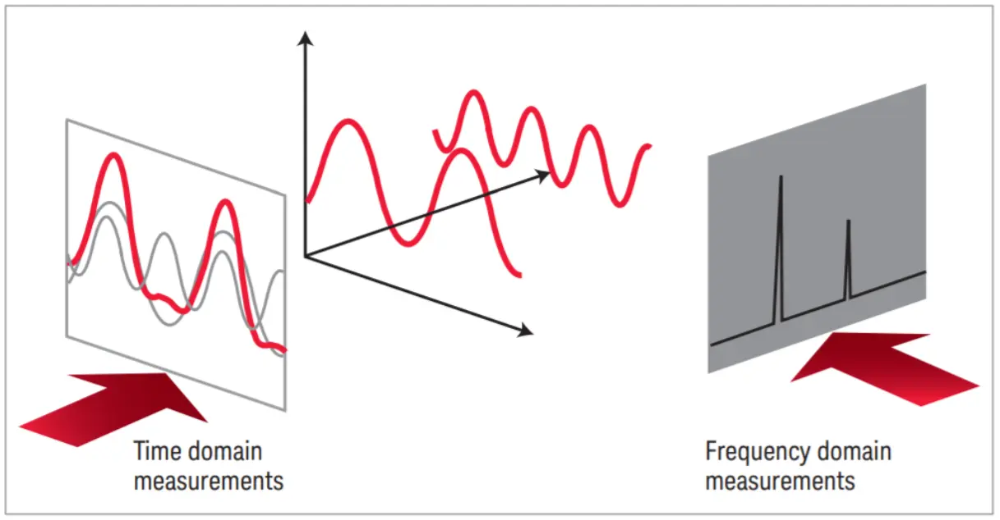
  <p><em>Source: <a href="https://docs.keysight.com/kkbopen/why-measuring-in-the-time-domain-and-frequency-domain-is-the-same-but-not-603167255.html">Why Measuring in the Time Domain and Frequency Domain Is the Same, but Not</a></em></p>
</div>

FFT works in the frequency domain, where each point represents a wave frequency rather than a world position. The FFT algorithm then converts the entire frequency domain into real world displacements (which live in the spatial domain) in one efficient pass. The beautiful thing about this, is that it's a lossless operation. We can convert our data between domains without losing any information. This is neat since we can remove certain frequencies from the equation, convert the data back to the spatial domain and have the exact same wave minus the removed frequency. You can imagine this like having a musical chord, say *C Major 7*. This chord contains the notes *C, E, G and B.* Using the FFT, you would be able to see every note that this chord signal contains, remove the B for example and convert it back to the spatial domain. The result would be a simple C Major chord which has the notes *C, E and G.*  
With this understanding of the FFT, we can now look at how Tessendorf uses it to build the ocean spectrum.

In his paper, Jerry Tessendorf describes the Phillips Spectrum as the model for defining wave energy. After implementing it I found it too limiting since its only parameters were wind speed and direction. So I switched to the JONSWAP spectrum, a more widely adopted model that gives much more creative freedom.
With JONSWAP you can control things like how many waves follow the wind direction, the choppiness of the waves, the distance over which the wind affects the surface, and the sharpness of the spectrum peak. This lets you model anything from a calm open ocean to a stormy sea with large aggressive swells.


### 1.1 The Setup

The ocean simulation is driven by a statistical wave spectrum. Rather than simulating individual water particles, the sea surface is represented as a collection of many sinusoidal waves. 

To simulate the ocean, the general idea is that we want to start by generating the initial representation of the heightfield in 2D space. We do this by using the wave spectrum in combination with a gaussian pseudo random number generator.  The gaussian random number is used to ensure that each wave component starts at a different point in its cycle. This way two oceans with the same parameters will still look different from each other. This random number becomes the $\xi_r + i\xi_i$ term in the H₀ formula, which we will see in section 1.3.

Tessendorf expresses the ocean height field as a sum of complex wave contributions across all frequencies. 
We represent the ocean surface using the formula:

$$h(\mathbf{x}, t) = \sum_{\mathbf{k}} \tilde{h}(\mathbf{k}, t) \exp(i\mathbf{k} \cdot \mathbf{x})$$

<div class="centered">

Where:<br>

$t$ - time  <br>
$\mathbf{x}$ - horizontal position on the ocean surface  <br>
$\mathbf{k}$ - a 2D wave vector with components $\mathbf{k} = (k_x, k_z)$  <br>
$k_x = \frac{2\pi n}{L_x}$   <br>
$k_z = \frac{2\pi m}{L_z}$  <br>
$n, m$ - integers in the range [$-N/2 \leq n < N/2$] and [$-M/2 \leq m < M/2$].  <br>
$\tilde{h}(\mathbf{k}, t)$ - complex amplitude encoding the amplitude and <strong>phase</strong> of the wave at frequency $\mathbf{k}$ and time $t$  <br>
$N, M$ - the resolution of the FFT grid <br>

</div>

 

<details>
<summary>  What is the phase of a wave? </summary>

The phase is the position of a wave within its cycle at any point in time. It is measured in radians, a phase value of 0 means the wave is at its peak, a phase value of $\frac{\pi}{2}$ means it has moved a quarter of a cycle on and crosses zero, and at $\pi$ it reaches its lowest point.

</details>

This heightfield is the result of the FFT converting the initial spectrum from the frequency domain to the spatial domain. This will be discussed in section 1.5.
The complex amplitude $\tilde{h}(\mathbf{k}, t)$ is the heart of this formula. It is what we need to construct for every wave vector $\mathbf{k}$ on our grid. To do this we need two things: the JONSWAP spectrum, which tells us how much energy each wave frequency should carry, and the dispersion relation, which tells us how fast each wave travels. *Section 1.3*.

The dispersion relation allows us to propagate this heightfield forward in time, animating the waves. This will need to be recalculated every frame to update the heightfield accordingly. The dispersion relation defines the relationship between angular frequency $\omega$ and the wave number $k$.  
In deep water, its formula is defined like this: 

$$\omega = \sqrt{gk}$$

$\omega$ - Angular frequency. How fast the wave oscillates in time (radians/sec)  
$g$ - Gravitational acceleration (9.81 m/s²)  
$k$ - The Wavenumber, in radians per meter: $k = \frac{2\pi}{\lambda}$, where $\lambda$ is the wavelength

<details>
<summary>  What is angular frequency? </summary>

Regular frequency describes how many full cycles happen in a second. For example: A wave that completes 3 cycles in a second has $f = 3$Hz.  
Angular frequency comes from thinking about this cycle rotating around a unit circle rather than oscillating up and down.  
A full rotation around a unit circle is $2\pi$. Angular frequency is simply the regular frequency multiplied by $2\pi$.

$$\omega = 2\pi f$$

</details>


For our implementation, we will be using the form that encodes a finite depth:

$$\omega = \sqrt{gk\tanh(kD)}$$

$D$ - Ocean Depth. Large values for D simplifies back to the base form while smaller values for D reduce the wave speed.

The dispersion relation formula is an approximation. There are many [different relationships](https://en.wikipedia.org/wiki/Dispersion_(water_waves)) you can choose to fit your ocean. 


With the general idea understood, we can now look at how the wave spectrum is constructed.


### 1.2 The Wave Spectrum

The wave spectrum is essentially a function that describes how the wave energy is distributed across combinations of angular frequencies $\omega$ and wind directions $\theta$.  


The JONSWAP spectrum formula looks like this: 

$$S_{\text{JONSWAP}}(\omega) = \text{scale} \cdot \phi_{TMA}(\omega) \cdot \frac{\alpha g^2}{\omega^5} \exp\left(-\frac{5}{4}\left(\frac{\omega_p}{\omega}\right)^4\right) \gamma^{\exp\left(-\frac{(\omega - \omega_p)^2}{2\sigma^2\omega_p^2}\right)}$$

<div class="centered">

Where:<br>

$\alpha$ - Energy scale, controls the overall wave height  <br>
$g$ - Gravitational acceleration (9.81 m/s²)  <br>
$\omega$ - Angular frequency of the wave being evaluated  <br>
$\omega_p$ - Peak frequency, the frequency with the most energy  <br>
$\gamma$ - Peak enhancement factor, controls the sharpness of the spectrum peak  <br>
$\sigma$ - Width parameter, 0.07 when $\omega \leq \omega_p$ and 0.09 when $\omega > \omega_p$  <br>
$\phi_{TMA}$ - TMA shallow water correction factor. Reduces the wave energy at shallow depths.   <br>

</div>

Before diving into each component of the JONSWAP, lets define a struct that will hold all the parameters that we will be populating.

```cpp
	struct JonswapParameters
	{
		float scale = 0.0f; // Used to scale the Spectrum [1.0f, 5.0f] 
		float spreadBlend = 0.0f; // Used to blend between agitated water motion, and windDirection [0.0f, 1.0f]
		float swell = 0.0f; // Narrows the spread around the wind direction: long, parallel crests [0.0f, 1.0f]
		float gamma = 0.0f; // Defines the Spectrum Peak [0.0f, 7.0f]
		float shortWavesFade = 0.0f; // [0.0f, 1.0f]

		float windDirection = 0.0f; // [0.0f, 360.0f]
		float fetch = 0.0f; // Distance in metres over which Wind impacts Wave Formation [1000.0f, 1000000.0f]
		float windSpeed = 0.0f; // [0.0f, 100.0f]

        // These values get calculated using the metrics above.
		float angle = 0.0f;
		float alpha = 0.0f;
		float peakOmega = 0.0f;
	}m_jonswapParams;

```

In code, calculating the JONSWAP spectrum looks like this:

```cpp

float Ocean::JONSWAP(float omega)
{
    float sigma = (omega <= m_jonswapParams.peakOmega) ? 0.07f : 0.09f; // width parameter
    float r = exp(-(omega - m_jonswapParams.peakOmega) * (omega - m_jonswapParams.peakOmega) / 2.0f / sigma / sigma / m_jonswapParams.peakOmega / m_jonswapParams.peakOmega); // peak enhancement
    float g = 9.81f; // gravity

    float oneOverOmega = 1.0f / (omega + 1e-6f);
    float peakOmegaOverOmega = m_jonswapParams.peakOmega / omega;

    return m_jonswapParams.scale * TMACorrection(omega) * m_jonswapParams.alpha * g * g * oneOverOmega * oneOverOmega * oneOverOmega * oneOverOmega * oneOverOmega 
			* exp(-1.25f * peakOmegaOverOmega * peakOmegaOverOmega * peakOmegaOverOmega * peakOmegaOverOmega) * pow(abs(m_jonswapParams.gamma), r);
}

```

The TMA (Texel Marsen Arsloe) correction is used for the non directional component of the wave spectrum. This means that it does not care about the direction the waves are moving, instead the TMA functions on the depth of the ocean. In shallow waters, the seabed starts to intervene with the waves. The waves slow down, their shape changes and their energy distribution across waves get shifted. TMA accounts for this and adjusts the JONSWAP spectrum by multiplying the spectrum with a depth dependent factor.

```cpp

float TMACorrection(float omega)
{
    float omegaH = omega * sqrt(OCEAN_DEPTH / 9.81f);
    if (omegaH <= 1.0f)
        return 0.5f * omegaH * omegaH;
    if (omegaH < 2.0f)
        return 1.0f - 0.5f * (2.0f - omegaH) * (2.0f - omegaH);

    return 1.0f;
}

```

Before we continue, lets populate our JonswapParameters. I recommend you play with the values to meet your desired artistic vision.  
We do need to calculate 3 of the variables: The `angle`, the `alpha` and the `peakOmega`.

```cpp

m_jonswapParams.angle = m_jonswapParams.windDirection / 180.0f * PI;
m_jonswapParams.alpha = JonswapAlpha(m_jonswapParams.fetch, m_jonswapParams.windSpeed);
m_jonswapParams.peakOmega = JonswapPeakFequency(m_jonswapParams.fetch, m_jonswapParams.windSpeed);

```

```cpp

float Ocean::JonswapAlpha(float fetch, float windSpeed)
{
    return 0.076f * pow(9.81f * fetch / windSpeed / windSpeed, - 0.22f);
}

float Ocean::JonswapPeakFequency(float fetch, float windSpeed)
{
    return 22.0f * pow(windSpeed * fetch / 9.81f / 9.81f, -0.33f);
}

```


Now that we have the wave spectrum, we can look at generating the initial heightfield.

### 1.3 Initial Spectrum Generation: H₀

We compute the initial spectrum once, my implementation does this on the CPU but its best done on the GPU since it can make great use of parallel computing.

The formula Tessendorf proposes in his paper is:

$$\tilde{h}_0(\mathbf{k}) = \frac{1}{\sqrt{2}}(\xi_r + i\xi_i)\sqrt{P_h(\mathbf{k})}$$

<div class="centered">

Where:<br>

$\tilde{h}_0(\mathbf{k})$ - The initial complex amplitude for wave vector $\mathbf{k}$. Encodes the amplitude and phase of one wave component.  <br>
$\mathbf{k}$ - A 2D wave vector representing the frequency and direction of a wave component.  <br>
$\xi_r$ - A Gaussian random number for the real part.  <br>
$\xi_i$ - A Gaussian random number for the imaginary part. <br> 
$P_h(\mathbf{k})$ - The wave spectrum energy at wave vector $\mathbf{k}$. In our implementation this is the JONSWAP spectrum.  <br>
$\frac{1}{\sqrt{2}}$ - A normalisation factor that ensures the correct distribution of wave amplitudes.<br>

</div>

This data lives in the frequency domain.  
We generate a complex number that encodes the amplitude and phase for every wave vector *k*. We store the resulting data in a R16G16B16A16_FLOAT texture.

Lets look at some code.

```cpp

void Ocean::GenerateH0(std::shared_ptr<CommandList> commandList, const UINT cascade) {

    float deltaK = 2.0f * PI / patchSize;
    float highestK = (OCEAN_SUBRES / 2.0f) * deltaK; // nyquist limit

    // stored in heap to avoid stack overflow
    std::vector<std::complex<float>> H0(OCEAN_SUBRES * OCEAN_SUBRES, { 0,0 });
    std::vector<std::complex<float>> H0Conj(OCEAN_SUBRES * OCEAN_SUBRES, { 0,0 });

    const float lowCutoff = cascade == 0 ? 0.001f : (OCEAN_SUBRES * PI / m_oceanPatchSizes[cascade - 1]); // nyquist limit of previous cascade;
    const float highCutoff = highestK;
    
    
    for (int m = 0; m < OCEAN_SUBRES; m++) {
        for (int n = 0; n < OCEAN_SUBRES; n++) {
            // Get wave vector for this frequency
            float kx = (n - OCEAN_SUBRES / 2.0f) * deltaK;
            float ky = (m - OCEAN_SUBRES / 2.0f) * deltaK;
            float k(sqrtf(kx * kx + ky * ky));

            if (k >= lowCutoff && k <= highCutoff)
            {
	            
            float kAngle = atan2(ky, kx);
            float omega = DispersionRelation(k);
            float dOmegadk = DispersionDerivative(k);

            float spectrum = JONSWAP(omega) * DirectionSpectrum(kAngle, omega) * ShortWavesFade(k);
            
            // Generate two independent gaussian random numbers
            float xiR = GaussianRandom();
            float xiI = GaussianRandom();

            float amplitude = sqrtf(2.0f * spectrum * fabsf(dOmegadk) / k * deltaK * deltaK);
            H0[m * OCEAN_SUBRES + n] = std::complex<float>(xiR * amplitude, xiI * amplitude);
            }
        }
    }

    // Needs its own loop since the conjugate needs all data of H0 to be valid
    for (int m = 0; m < OCEAN_SUBRES; m++) {
        for (int n = 0; n < OCEAN_SUBRES; n++) {
            int m_minus = (OCEAN_SUBRES - m) % OCEAN_SUBRES;
            int n_minus = (OCEAN_SUBRES - n) % OCEAN_SUBRES;
            H0Conj[m * OCEAN_SUBRES + n] = std::conj(H0[m_minus * OCEAN_SUBRES + n_minus]);
        }
    }

    std::vector<uint16_t> combinedData(OCEAN_SUBRES * OCEAN_SUBRES * 4);

    for (int m = 0; m < OCEAN_SUBRES; m++) {
        for (int n = 0; n < OCEAN_SUBRES; n++) {
            int index = (m * OCEAN_SUBRES + n) * 4;
            combinedData[index + 0] = FloatToHalf(H0[m * OCEAN_SUBRES + n].real());       // R: H0 real
            combinedData[index + 1] = FloatToHalf(H0[m * OCEAN_SUBRES + n].imag());       // G: H0 imaginary
            combinedData[index + 2] = FloatToHalf(H0Conj[m * OCEAN_SUBRES + n].real());   // B: H0_conj real
            combinedData[index + 3] = FloatToHalf(H0Conj[m * OCEAN_SUBRES + n].imag());   // A: H0_conj imaginary
        }
    }

    D3D12_SUBRESOURCE_DATA subData = {};
    subData.pData = combinedData.data();
    subData.RowPitch = OCEAN_SUBRES * 4 * sizeof(uint16_t); // 4 channels * 2 bytes
    subData.SlicePitch = subData.RowPitch * OCEAN_SUBRES;

    commandList->CopyTextureSubresource(m_oceanCascades[cascade].H0Texture, 0, 1, &subData);
}

```

Lets dissect this.  
`deltaK` is the spacing between frequency samples. Since our patch covers `patchSize` metres in the real world, dividing $2\pi$ by it gives us the step size in frequency space.  
`highestK` is the Nyquist limit, the highest frequency our grid can represent before aliasing occurs.  
`lowCutoff` and `highCutoff` can be ignored for now, these will be explained in Chapter 4.  

**The double for loop**  
For each grid position $(n, m)$ we compute the wave vector components `kx` and `ky`. Subtracting `OCEAN_SUBRES / 2.0f` centers the grid around zero so we cover both positive and negative frequencies, representing waves travelling in all directions.  
`k` is the magnitude of the wave vector, the wavenumber.  

**Computing the spectrum value**  
For each wave vector we compute three things.  
`kAngle` is the direction the wave is travelling.  
`omega` is the angular frequency from the dispersion relation.  
The full spectrum value is then the product of three functions. JONSWAP gives the total energy at this frequency.  
`DirectionSpectrum` distributes that energy across directions based on `kAngle`.  
`ShortWavesFade` damps out very high frequencies to prevent aliasing artifacts.  

<details>
<summary>How does directional spreading work?</summary>

The JONSWAP spectrum $S(\omega)$ only tells us how much energy a wave of a certain frequency should have. It says nothing about which direction that energy travels. The directional spreading function $D(\omega, \theta)$ solves this by distributing the energy across directions. Multiplying them together gives us the full directional spectrum:

$$S(\omega, \theta) = S(\omega) \cdot D(\omega, \theta)$$

The spreading function we use is based on the Longuet-Higgins form, which most empirical models share:

$$D(\omega, \theta) = Q(s) \cdot |\cos(\theta/2)|^{2s}$$

The parameter $s$ controls how concentrated the energy is around the wind direction. A large $s$ means waves are tightly focused along the wind. A small $s$ means energy spreads out in all directions. $Q(s)$ is a normalisation factor that ensures the total energy across all directions sums to 1.

In code, <code>Cosine2s</code> is this function and <code>NormalizationFactor</code> is $Q(s)$, computed using a polynomial approximation rather than the exact Euler gamma function for performance reasons. <br>
<br>

<strong>Computing $s$: the Hasselmann model</strong> <br>

We use the Hasselmann empirical model to compute $s$ based on how far the current frequency is from the peak frequency $\omega_p$:

<pre><code class="language-cpp">
float SpreadPower(float omega, float peakOmega)
{
    if (omega > peakOmega)
        return 9.77f * pow(abs(omega / peakOmega), -2.5f);
    else
        return 6.97f * pow(abs(omega / peakOmega), 5.0f);
}
</code></pre>

The constants <code>9.77</code> and <code>6.97</code> come directly from Horvath's paper. Frequencies near the peak get a high $s$ value, meaning they are focused along the wind. Frequencies far above the peak get a low $s$, spreading more freely in all directions. <br>
<br>

<strong>The swell parameter</strong> <br>

On top of the Hasselmann base value, we add a swell contribution:

$$s_\xi = 16 \tanh\left(\frac{\omega_p}{\omega}\right)\xi^2$$

Where $\xi$ is the <code>swell</code> parameter. Increasing swell adds to $s$, making waves more elongated and parallel, simulating waves that have travelled from a distant storm rather than being generated by local wind. <br>
<br>

<strong>Blending with spreadBlend</strong> <br>

The final spreading function blends between two models based on the <code>spreadBlend</code> parameter:

<pre><code class="language-cpp">
return lerp(
    2.0f / PI * cos(theta - angle) * cos(theta - angle),  // simple cosine squared, broad spreading
    Cosine2s(theta - angle, s),                            // full Hasselmann + swell spreading
    spreadBlend
);
</code></pre>

A <code>spreadBlend</code> of 0 gives a simple spreading where all wavelengths spread equally regardless of frequency. A <code>spreadBlend</code> of 1 gives the full empirical Hasselmann model with swell. Values in between blend the two, giving you creative control over how directional the ocean looks.

</details>

**Computing the amplitude and storing H₀**
Two independent Gaussian random numbers give each wave component a unique random phase. The amplitude formula converts the continuous spectrum density into a discrete amplitude value for this specific grid cell, accounting for the cell size `deltaK * deltaK`. Multiplying the random numbers by the amplitude gives us $\tilde{h}_0(\mathbf{k})$, stored as a unique complex number.

**The Conjugate**  
The conjugate is simply the sign mirror of a complex number. For example the conjugate of $z = a + bi$ is $z^* = a - bi$. This conjugate is needed since the FFT takes complex numbers as input and produces a complex number as an output too. Our heightfield needs to use real numbers, so using the conjugate we can cancel out the imaginary part of the FFT output, leaving us with only real values. for example:

$$ (a + bi) + (a - bi) = 2a $$

**Texture Packing**  
Both H0 and its conjugate are packed into a single RGBA texture. The real and imaginary parts of H0 go into the R and G channels, the conjugate goes into B and A. The values are converted to 16 bit half precision floats to save memory. This texture is then uploaded to the GPU where the compute shader will read it every frame to propagate the waves forward in time.


This function provides us with the initial spectrum texture. You can visualize this texture in your preferred graphics debugger, I'm using RenderDoc. *You will need to change the color range to a very small value to see the colors clearly*.

<div class="centered">
  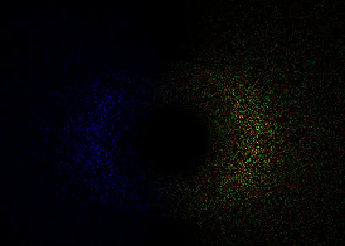
  <p><em>Your version might look slightly less colorful, mine is using multiple frequency bands which will be covered in Chapter 4.</em></p>
</div>

Next we will bring this spectrum to life by animating it over time, and then look at how the FFT transforms the frequency domain data into real world wave displacements.


### 1.4 Time Evolution: Animating the Waves

The next step now that we have the initial spectrum, is to bring our static data to life by animating it over time. Tessendorf provides us with the following formula:

$$\tilde{h}(\mathbf{k}, t) = \tilde{h}_0(\mathbf{k})\,e^{i\omega(k)t} + \tilde{h}_0^*(-\mathbf{k})\,e^{-i\omega(k)t}$$

Every frame, we take our initial spectrum $\tilde{h}_0(\mathbf{k})$ and multiply it by $e^{i\omega t}$. From Euler's formula we know that this advances the phase of each wave component forward in time at its own speed, determined by the dispersion relation. The second term $\tilde{h}_0^*(-\mathbf{k})\,e^{-i\omega(k)t}$ is the conjugate we discussed earlier, ensuring the output remains a real value.

One important detail is that we use a rounded version of $\omega$ when computing the time evolution. This ensures that every wave component completes full cycles within a fixed time period, so the ocean animation loops seamlessly without any visible discontinuity. 

So we have the initial spectrum and its conjugate, the last missing term is the dispersion relation and the $e^{i\omega t}$ which we will calculate now.  
Since we want to loop the animation, we need to introduce a new variable: `REPEAT_TIME`. Using this variable we can control the amount of time it takes for the simulation to loop back to its original state. I'm using a value of 500 but feel free to play around with this.  

First we load our initial spectrum and conjugate data.

<pre><code class="cpp">
float4 H0Data = H0Texture.Load(int3(dispatchThreadID.xy, 0));
float2 h0 = H0Data.rg;
float2 h0conj = H0Data.ba;

float kx = 2.0f * PI * (dispatchThreadID.x - OCEAN_RESOLUTION / 2.0f) / patchSize;
float ky = 2.0f * PI * (dispatchThreadID.y - OCEAN_RESOLUTION / 2.0f) / patchSize;
float k = length(float2(kx,ky));
float kRcp = rcp(k);

// Prevent NaN values
if (k < 0.0001f)
{
    kRcp = 1.0f;
}
</code></pre>

We calculate the base frequency step.

<pre><code class="cpp">
float w = 2.0f * PI / REPEAT_TIME;
</code></pre>

We can use this value as the stepsize around the unit circle and use `time` as the scalar that advances the dispersion.

<pre><code class="cpp">
float dispersion = floor(sqrt(GRAVITY * k) / w) * w * time;
</code></pre>

Note that this uses the deep water form $\omega = \sqrt{gk}$, while H₀ is built with the finite depth version from section 1.1. At my depth of 20 metres this makes the longest waves move a little too fast. If you want them to match, use the same dispersion function in both places.

We now plug this dispersion into Euler's formula which gives us $e^{i\omega t}$. Add these helper functions:  

<pre><code class="cpp">

float2 EulerFormula(float x)
{
    return float2(cos(x), sin(x));
}

float2 complex_multiply(float2 W, float2 B)
{
    return float2(W.x * B.x - W.y * B.y,
                  W.x * B.y + W.y * B.x);
}

float2 exponent = EulerFormula(dispersion);
</code></pre>

Now we have all the components to calculate $\tilde{h}(\mathbf{k}, t)$  
<pre><code class="cpp">
float2 htilde = complex_multiply(h0, exponent) + complex_multiply(h0conj, float2(exponent.x, -exponent.y));
</code></pre>

We now successfully computed the heightfield in the frequency domain. Next to this, we also want to have the *horizontal displacement* and the *surface slope*. The horizontal displacement will make the waves look choppy and the slopes are used to calculate the surface normals which we will be using in Chapter 2 for lighting calculations.  

From the animated spectrum $\tilde{h}(\mathbf{k}, t)$ we can derive everything we need in 
one pass. Rather than running separate FFTs for height, horizontal displacement and surface 
slopes, we compute all of them in the frequency domain before the FFT using a property of 
Fourier transforms: taking a spatial derivative in the real world is equivalent to 
multiplying by $ik$ in the frequency domain.

First we precompute $i\tilde{h}$, which is just the complex number rotated 90 degrees:

<pre><code class="cpp">
float2 ih = float2(-htilde.y, htilde.x);
</code></pre>

Then we derive each output signal:

<pre><code class="cpp">
// the raw height field, becomes vertical displacement after the FFT
float2 displacementY = htilde;
// horizontal displacement in x and z, pointing in the wave travel direction
float2 displacementX = ih * kx * kRcp;
float2 displacementZ = ih * ky * kRcp;
// the surface slopes in x and z, used to compute normals for lighting
float2 displacementY_dx = ih * kx;
float2 displacementY_dz = ih * ky;
// second order derivatives used to compute the Jacobian determinant for foam detection. Covered in Chapter 3. 
float2 displacementZ_dx = -htilde * kx * ky * kRcp;
float2 displacementZ_dz = -htilde * ky * ky * kRcp;
float2 displacementX_dx = -htilde * kx * kx * kRcp;
</code></pre>

The negative sign on the second order derivatives comes from applying the $ik$ multiplication 
twice: $i^2 = -1$, so $ik \cdot ik = -k^2$.

All eight signals are then packed into two float4 textures and converted to the spatial 
domain by the FFT in the next pass.

<pre><code class="cpp">
float2 htildeDisplacementX = float2(displacementX.x - displacementZ.y, displacementX.y + displacementZ.x);
float2 htildeDisplacementZ = float2(displacementY.x - displacementZ_dx.y, displacementY.y + displacementZ_dx.x);
    
float2 htildeSlopeX = float2(displacementY_dx.x - displacementY_dz.y, displacementY_dx.y + displacementY_dz.x);
float2 htildeSlopeZ = float2(displacementX_dx.x - displacementZ_dz.y, displacementX_dx.y + displacementZ_dz.x);


displacementTexture[dispatchThreadID.xy] = float4(htildeDisplacementX, htildeDisplacementZ);
slopeTexture[dispatchThreadID.xy] = float4(htildeSlopeX, htildeSlopeZ);
</code></pre>

With this, we now have the heightfield, horizontal displacement and slopes, all calculated in the frequency domain. The last step is to transform this data to the spatial domain.


<!-- [ Explain how animate_waves.hlsl works — the dispersion relation ω = √(g·k), Euler's formula for complex exponentials, and why you accumulate total time rather than per-frame deltaTime. ] -->

### 1.5 The Butterfly FFT

The ocean simulation depends on converting a frequency domain wave spectrum into real displacement values every frame. That conversion is an Inverse Fast Fourier Transform. In this section I will explain the idea behind this transformation and how it works. To not make this article too long/complex, I will not go too much into detail since understanding it fully is not required to make it work. If you are brave enough you can dive deeper and read the paper by [Flügge](https://tore.tuhh.de/bitstream/11420/1439/1/GPGPU_FFT_Ocean_Simulation.pdf) and [Matusiak](https://www.ti.com/lit/an/spra291/spra291.pdf?ts=1607161475507&ref_url=https%3A%2F%2Fwww.google.com%2F).


<details>
<summary>  The DFT: correct but slow </summary>

The Discrete Fourier Transform is defined as:  

$$F[k] = \sum_{n=0}^{N-1} f[n] \cdot e^{-i \frac{2\pi}{N} kn}$$

For each output frequency $k$, you multiply every input sample $f[n]$ by a complex rotation factor and sum the results. If you have $N$ samples and $N$ output frequencies, that is $N$ multiplications per output and $N$ outputs. A total of $N^2$ operations. For $N = 512$ that is 262,144 complex multiplications per row, per column, per frame. That is not viable in real time.

The FFT computes the exact same result in $O(N \log N)$ time. For $N = 512$ that is roughly 4,608 operations. The result is identical.

***The key insight: reuse***

Consider $N = 4$. Since $e^{-i\pi/2} = -i$, the twiddle factor simplifies to $(-i)^{kn}$, and the four outputs expand to:

$$F[0] = f[0] + f[1] + f[2] + f[3]$$
$$F[1] = f[0] - if[1] - f[2] + if[3]$$
$$F[2] = f[0] - f[1] + f[2] - f[3]$$
$$F[3] = f[0] + if[1] - f[2] - if[3]$$

Look at $F[0]$ and $F[2]$. Both contain $f[0] + f[2]$ and $f[1] + f[3]$, just combined differently. Look at $F[1]$ and $F[3]$. Both contain $f[0] - f[2]$ and $f[1] - f[3]$. The naive DFT computes each output independently, so it recomputes these components four separate times. The FFT computes them once and reuses them across all outputs. This is the entire idea.

</details>

<details>
<summary>  The butterfly </summary>

The reusable building block is called a butterfly. Given two complex numbers $a$ and $b$ and a twiddle factor $W$, one butterfly produces:

$$A = a + W \cdot b$$
$$B = a - W \cdot b$$

One addition and one subtraction, both reading from the same two inputs. For general $N$ the twiddle factor is:

$$W_N^k = e^{-i \frac{2\pi}{N} k}$$

This is a point on the unit circle in the complex plane, a rotation by $k$ steps of $\frac{2\pi}{N}$ radians. In the shader this is computed as:

<pre><code class="language-cpp">
float angle = -2.0f * PI * float(w) / float(TOTALPOINTS);
float2 twiddle = float2(cos(angle), -sin(angle));
</code></pre>

Look closely at the signs: with `angle` negative, this works out to $e^{+i \frac{2\pi}{N} w}$, the conjugate of $W_N^w$. That is exactly what we want, because we're running the *inverse* FFT (frequency domain to spatial domain), which uses the positive exponent.

</details>

<details>
<summary>  The Stages </summary>

For $N = 4$ the FFT runs in two stages:

**Stage 1** runs two butterflies, one on $f[0], f[2]$ and one on $f[1], f[3]$. This produces four intermediate values.

**Stage 2** feeds those intermediate values into two more butterflies to produce the final outputs $F[0], F[1], F[2], F[3]$.

For general $N$ there are $\log_2 N$ stages, and each stage runs $N/2$ butterflies. Total work is therefore:

$$\frac{N}{2} \times \log_2 N$$

which is $O(N \log N)$.

In the shader this is the outer loop:

<pre><code class="language-cpp">
for (uint stage = 0; stage < log2(TOTALPOINTS); ++stage)
</code></pre>

Each iteration is one full stage, $N/2$ butterflies, all executing in parallel across the thread group.

</details>

<details>
<summary>  Ping pong buffers </summary>


Each stage reads from the previous stage's output and writes its results somewhere else, you cannot read and write the same memory simultaneously on the GPU. The shader handles this with a double buffer and a flag that alternates each stage:

<pre><code class="language-cpp">
groupshared float2 bufferRG[2][TOTALPOINTS];
groupshared float2 bufferBA[2][TOTALPOINTS];

uint flag = 0;
for (uint stage = 0; stage < log2(TOTALPOINTS); ++stage)
{
    bufferRG[1 - flag][groupIndex] = bufferRG[flag][i] + complex_multiply(twiddle, bufferRG[flag][i + b]);
    flag = 1 - flag;
    GroupMemoryBarrierWithGroupSync();
}
</code></pre>

Stage 0 reads from buffer 0, writes to buffer 1. Stage 1 reads from buffer 1, writes to buffer 0. This alternates for all $\log_2 N$ stages. The final result sits in whichever buffer `flag` points to after the loop.

The two buffer pairs, `bufferRG` and `bufferBA` exist because the shader processes two complex signals simultaneously, packed into the four channels of a `float4` texture. This halves the number of texture reads and compute passes needed.

</details>

<details>
<summary>  Bit Reversal </summary>

For the butterfly stages to chain correctly, the input samples need to be fed in a specific order before stage 0. That order is bit reversal of the index, where the binary representation of each index is reversed and samples are shuffled accordingly. Index 1 (`001`) swaps with index 4 (`100`), for example. This reordering is a known property of the Cooley-Tukey Radix-2 algorithm, and the paper handles it as a separate permutation pass before the FFT runs.

Garrett Gunnell takes a slightly different approach and skips the separate permutation pass entirely. Instead, the bit reversal is folded into the butterfly index arithmetic directly. At each stage, each thread computes the correct source indices on the fly:

<pre><code class="language-cpp">
uint b = TOTALPOINTS >> (stage + 1);
uint w = b * (groupIndex / b);
uint i = (w + groupIndex) % TOTALPOINTS;
</code></pre>

`i` and `i + b` are the two input positions for this thread's butterfly. Rather than pre shuffling the data once upfront, the shader just reaches into the buffer at the correct positions at every stage. The end result is exactly the same, the reordering still happens, it is just computed inline rather than as a separate dispatch.

</details>

<details>
<summary>  2 Passes: Rows then columns </summary>

A 2D FFT on an $N \times N$ texture is separable. You run the 1D FFT on every row, then run the 1D FFT on every column of the result. The shader handles both passes with a single `columnPass` constant:

<pre><code class="language-cpp">
if (columnPass)
    data = outputTexture.Load(int3(groupID.x, groupIndex, 0));
else
    data = outputTexture.Load(int3(groupIndex, groupID.x, 0));
</code></pre>

When `columnPass` is 0, each thread group processes one row. When `columnPass` is 1, it processes one column. The dispatch is called twice from the CPU with the constant toggled between passes.

</details>


<details>
<summary>  The complete FFT shader </summary>

<pre><code class="language-cpp">
groupshared float2 bufferRG[2][TOTALPOINTS];
groupshared float2 bufferBA[2][TOTALPOINTS];

[numthreads(TOTALPOINTS, 1, 1)]
void main(uint3 dispatchThreadID : SV_DispatchThreadID, uint3 groupID : SV_GroupID, uint groupIndex : SV_GroupIndex)
{
    float4 data;
    if (columnPass)
        data = outputTexture.Load(int3(groupID.x, groupIndex, 0)); // column: x fixed, y varies
    else
        data = outputTexture.Load(int3(groupIndex, groupID.x, 0)); // row: x varies, y fixed

    bufferRG[0][groupIndex] = data.rg;
    bufferBA[0][groupIndex] = data.ba;

    GroupMemoryBarrierWithGroupSync();
    
    uint flag = 0;
    for (uint stage = 0; stage < log2(TOTALPOINTS); ++stage)
    {
        uint b = TOTALPOINTS >> (stage + 1);
        uint w = b * (groupIndex / b);
        uint i = (w + groupIndex) % TOTALPOINTS;

        float angle = -2.0f * PI * float(w) / float(TOTALPOINTS);
        float2 twiddle = float2(cos(angle), -sin(angle));

        bufferRG[1 - flag][groupIndex] = bufferRG[flag][i] + complex_multiply(twiddle, bufferRG[flag][i + b]);
        bufferBA[1 - flag][groupIndex] = bufferBA[flag][i] + complex_multiply(twiddle, bufferBA[flag][i + b]);

        flag = 1 - flag;
        GroupMemoryBarrierWithGroupSync();
    }

    float2 resultRG = bufferRG[flag][groupIndex];
    float2 resultBA = bufferBA[flag][groupIndex];

    if (columnPass)
        outputTexture[int2(groupID.x, groupIndex)] = float4(resultRG, resultBA);
    else
        outputTexture[int2(groupIndex, groupID.x)] = float4(resultRG, resultBA);
}

</code></pre>

</details>

Putting all this together, after both passes complete we have converted our wave spectrum from the frequency domain into real spatial data. Before we can use this data to displace our vertices, we need to apply one last step to correctly arrange it.

### 1.6 Permuting the FFT Output

Before we can use the FFT results, we need to apply two final steps: fixing the signs of the output and unpacking our signals.

#### Fixing the signs

Remember that in section 1.3 we stored the spectrum *centered*, with the zero frequency in the middle of the texture (that's the `- OCEAN_SUBRES / 2.0f` in the wave vector). The FFT however expects the zero frequency at index 0, in the corner. Shifting the input by half the texture like this has a side effect on the output: every other texel comes out with its sign flipped, in a checkerboard pattern. We undo that with the following permute function:

<pre><code class="language-cpp">
float4 Permute(float4 data, float3 id)
{
    return data * (1.0f - 2.0f * ((id.x + id.y) % 2));
}
</code></pre>

This flips the sign of every other texel in the same checkerboard pattern, which cancels out the flip. Skip this step and your ocean turns into an obvious checkerboard of up and down spikes.

#### Unpacking the signals

Back in the wave animation pass we packed multiple signals into two float4 textures to save GPU passes. Now we unpack them:

<pre><code class="language-cpp">
float2 dxdz   = htildeDisplacement.rg;  // horizontal displacement in X and Z
float2 dydxz  = htildeDisplacement.ba;  // vertical displacement Y, and the Dxz cross derivative
float2 dyxdyz = htildeSlope.rg;         // surface slopes in X and Z, used for normals
float2 dxxdzz = htildeSlope.ba;         // second derivatives Dxx and Dzz, used for the Jacobian (Expanded upon in Chapter 3)
</code></pre>

#### Applying choppiness

The horizontal displacements are scaled by a factor called Lambda before being applied to the mesh. Lambda controls how choppy the waves look. A value of 0 gives smooth rolling swells, higher values pull the surface points towards the crests, which makes the crests sharper and the troughs wider, like the peaked shapes you see on a real ocean surface.

<pre><code class="language-cpp">
float3 displacement = float3(Lambda.x * dxdz.x, dydxz.x, Lambda.y * dxdz.y);
</code></pre>

The slopes used for normal calculation get a Lambda correction too. In areas of strong horizontal displacement the surface is being stretched and compressed, which would cause the normal map to produce incorrect results without accounting for it:

<pre><code class="language-cpp">
float2 slopes = dyxdyz.xy / (1 + abs(dxxdzz * Lambda));
</code></pre>

Finally we store this data in their corresponding textures:

<pre><code class="language-cpp">
slopeTexture[dispatchThreadID.xy] = float4(slopes, Lambda.x * dxxdzz.x, Lambda.y * dxxdzz.y); // .ba are used for the foam in Chapter 3
displacementTexture[dispatchThreadID.xy] = float4(displacement, 0.0f);
</code></pre>

With this, the hard part is behind us. Take a look at the contents of the texture, it should look something like this:


<div class="centered">
  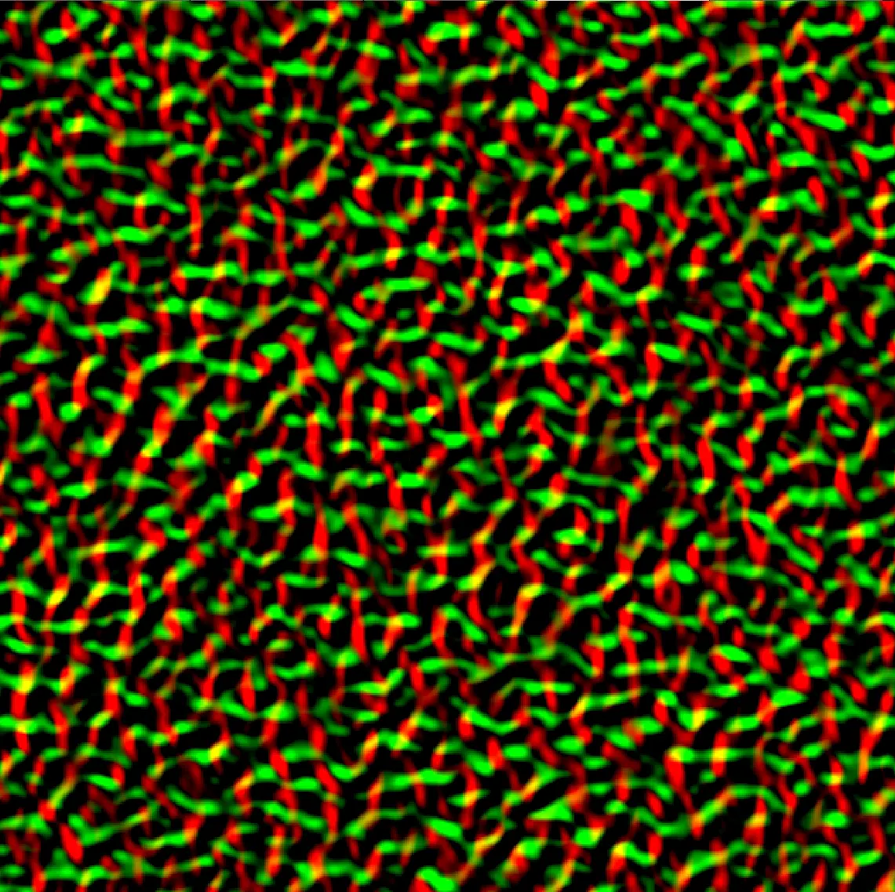
</div>

<div class="centered">
  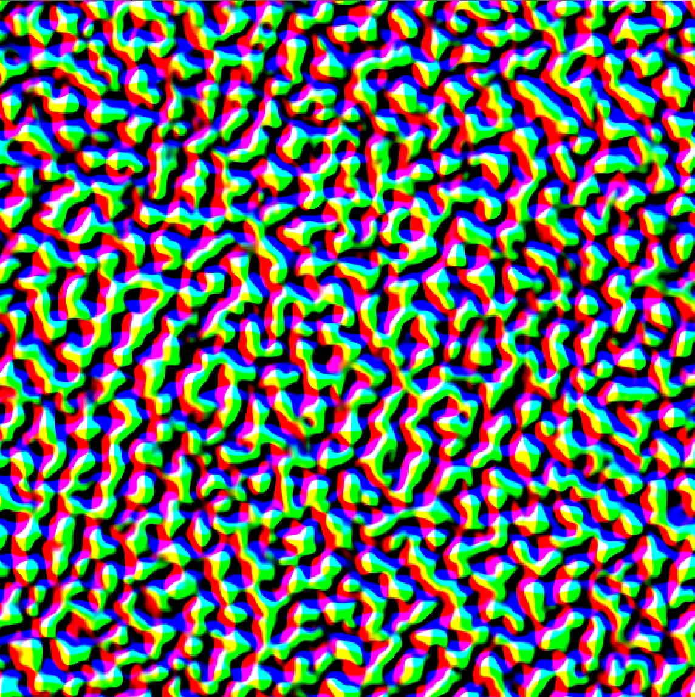
</div>


You've successfully created the slope and displacement textures! In the next chapter I will show you how to use these textures to render the Ocean.

---


## Chapter 2 Rendering & Shading

### 2.1 Vertex Displacement

At this point we have two textures coming out of the permute pass: a displacement texture and a slope texture. The displacement texture holds the XYZ offset to apply to each vertex. The slope texture holds the surface derivatives we need to reconstruct the surface normal in the pixel shader.

The ocean mesh is just a flat grid of vertices. In the vertex shader, each vertex samples the displacement texture and adds the result to its position. The UV coordinates are derived from world-space position divided by the patch size.

<pre><code class="language-cpp">
float2 uv = data.Position.xz / patchSize;

float3 displacement = DisplacementTexture.SampleLevel(linearWrapSampler, uv, 0).rgb;

displacedPosition += displacement;
</code></pre>

Make sure you use a **WRAP** sampler here, not CLAMP. With CLAMP, every vertex outside the [0,1] UV range samples the border value and you end up with a completely flat ocean.

### 2.2 Normal Reconstruction & Shading

In the pixel shader, sample the slope texture using the same world-space UV. Reconstructing the surface normal from the slopes is a single line:

<pre><code class="language-cpp">
float2 uv = IN.PositionWS.xz / patchSize;
float4 slope = SlopeTexture.Sample(anisotropicSampler, uv);
float3 normal = normalize(float3(-slope.x, 1.0f, -slope.y));
</code></pre>

This gives you a smooth normal that captures all the surface detail baked into the slope texture. From here you can use this normal however you like, whether that is a simple diffuse and specular shading model or a full PBR setup. My implementation uses GGX specular for the sun, Image Based Lighting for the sky and a subsurface scattering approximation at the wave crests. The rest of this chapter walks through each of them.

If everything is wired up correctly you should have a shaded animated ocean.

<div class="centered">
  <video width="100%" controls autoplay loop muted playsinline>
    <source src="/assets/img/posts/OceanRender/topDown.mp4" type="video/mp4">
  </video>
</div>


<div><style>
.ocean-fig{display:block;width:100%;max-width:680px;height:auto;margin:0 auto}
.ocean-fig text{fill:var(--light-text-color,#48484a);font-size:13px;font-family:inherit}
.ocean-fig text.small{font-size:11px}
.ocean-fig text.title{font-weight:bold}
.ocean-fig text.accent-text{fill:#f69801}
.ocean-fig text.on-dark{fill:#ffffff}
.ocean-fig text.on-light{fill:#10283c}
.ocean-fig .ink{stroke:var(--light-text-color,#48484a);fill:none;stroke-width:1.5}
.ocean-fig .ink-fill{fill:var(--light-text-color,#48484a)}
.ocean-fig .faint{stroke:var(--light-border-color,#cccccc);fill:none;stroke-width:1}
.ocean-fig .dashed{stroke-dasharray:4 3}
.ocean-fig .box{fill:var(--box-background-color,#f9f9fa);stroke:var(--light-border-color,#cccccc);stroke-width:1.2}
.ocean-fig .box-accent{fill:var(--box-background-color,#f9f9fa);stroke:#f69801;stroke-width:2}
.ocean-fig .water{fill:#2f86c9;fill-opacity:.22;stroke:#2f86c9;stroke-width:2}
.ocean-fig .wave{fill:none;stroke:#2f86c9;stroke-width:2.2}
.ocean-fig .dot{fill:#2f86c9}
.ocean-fig .accent{stroke:#f69801;fill:none;stroke-width:2}
.ocean-fig .accent-fill{fill:#f69801}
.ocean-fig .scatter{fill:#1fb5a3;fill-opacity:.4}
.ocean-fig .scatter-line{stroke:#1fb5a3;fill:none;stroke-width:2.2}
.ocean-fig .foam{fill:#f69801;fill-opacity:.18;stroke:#f69801;stroke-width:1.5;stroke-dasharray:3 2}
</style></div>

Right now the ocean is lit, but it doesn't really look like water yet. In the next sections we'll build up the final color one term at a time. To give you a map of where we're going, this is (slightly simplified) how the ocean pixel shader puts everything together at the end:

<pre><code class="language-cpp">
// simplified from ocean_pixel.hlsl
float3 ambient = specular + body;                                  // sky reflection (2.4) + water body (2.3)
float3 color   = directionalLightBRDF + ambient * IBLIntensity + sss; // sun glint (2.3) + subsurface scattering (2.5)
color = lerp(color, foamColor, foamCoverage);                      // foam (Chapter 3)
</code></pre>

### 2.3 Sunlight & Water Color

When I first got the ocean shaded, I treated it like every other PBR material in my engine: a Lambert diffuse term for the color, plus a GGX specular term on top. It worked, but the ocean always looked a bit like blue plastic.

The reason is that water isn't really a diffuse surface. When light hits the ocean, a small part of it is reflected straight away. The rest refracts into the water, bounces around between water molecules and tiny particles, gets partly absorbed (red light goes first, which is why deep water looks blue) and some of it finds its way back out again. The color of the sea comes from that volume *underneath* the surface, not from the surface itself.

So in my shader the sun only produces a specular highlight. The color comes from two other terms: the *water body* at the end of this section, and the subsurface scattering in section 2.5.

**The sun glint**

For the highlight I use the standard Cook-Torrance microfacet BRDF. The idea behind microfacets is that a surface that looks smooth is, up close, made of millions of tiny mirrors that each point in a slightly different direction. The BRDF basically asks: how many of those tiny mirrors are angled exactly right to bounce the sunlight into the camera?

$$f_{spec} = \frac{D \cdot G \cdot F}{4\,(\mathbf{n} \cdot \mathbf{v})(\mathbf{n} \cdot \mathbf{l})}$$

<div class="centered">

Where:<br>

$D$ - Normal distribution function (GGX). The fraction of microfacets that face exactly between the sun and the camera. Low roughness gives a small, bright highlight, high roughness a wide and dim one. <br>
$G$ - Geometry term (Schlick-GGX). Microfacets can block each other, mostly at grazing angles. This term removes the light that gets blocked. <br>
$F$ - Fresnel (Schlick). How much light is reflected instead of refracted into the water, depending on the angle. <br>
$\mathbf{n}, \mathbf{v}, \mathbf{l}$ - The surface normal, the direction to the camera and the direction to the sun. <br>

</div>

For water, the Fresnel term starts at $F_0 = 0.02$. This number comes straight from water's index of refraction, which is about 1.33:

$$F_0 = \left(\frac{n - 1}{n + 1}\right)^2 = \left(\frac{0.33}{2.33}\right)^2 \approx 0.02$$

So when you look straight down, only 2% of the light is reflected. At grazing angles that goes up to almost 100%. You can see this at any beach: the water at your feet is see through, while the sea near the horizon is a mirror of the sky. This one small number does a surprising amount of the work in making water look like water.

<pre><code class="language-cpp">
float3 F0 = float3(0.02f, 0.02f, 0.02f);

float3 dirLightDir = normalize(-DirectionalLights[0].DirectionWS.xyz);
float3 halfVec = normalize(viewDirWS + dirLightDir);
float HdotV = max(dot(halfVec, viewDirWS), 0.0f);

float normDist = PBRCalculateNormalDistribution(roughness, normal, halfVec);       // D
float geometryFunc = PBRCalculateGeometry(normal, viewDirWS, dirLightDir, roughness); // G
float3 fresnel = PBRCalculateFresnel(HdotV, F0);                                    // F

// Specular only: water's color comes from the volume (body + sss), not from a Lambert surface.
directionalLightBRDF += PBRSpecular(normDist, geometryFunc, fresnel, viewDirWS, dirLightDir, normal)
                      * DirectionalLights[0].Color * max(dot(dirLightDir, normal), 0.0f);
</code></pre>

I briefly tried a Beckmann distribution instead of GGX, since some of the older ocean papers use it. Beckmann falls off quickly away from the center of the highlight, while GGX has a longer "tail", which gives the sun glint a soft glow around it. That glow looks a lot like the sparkling band of light you see on the sea at sunset, so I kept GGX. It also matches the image based lighting in the next section, which is baked with GGX, so the sun and the sky reflections behave the same way.

**Roughness that grows with distance**

Close to the camera the water is smooth, which gives tight, sharp glints. Far away, a single pixel covers a lot of tiny waves that neither the mesh nor the slope textures can resolve. Those waves still exist though, and from far away they behave exactly like microfacets: they scatter the light around. So the further away a pixel is, the rougher the water should look. Without this, the distant ocean turns into a noisy surface of single pixel sparkles.

I blend between a near and a far roughness with an exponential, so the change is quick close by and levels off in the distance:

$$\text{roughness} = \text{lerp}\left(0.08,\; 0.3,\; 1 - e^{-d / 300}\right)$$

where $d$ is the distance to the camera in metres.

<pre><code class="language-cpp">
static const float ROUGHNESS_NEAR = 0.08f;
static const float ROUGHNESS_FAR = 0.3f;
static const float ROUGHNESS_DISTANCE = 300.0f; // metres

float viewDistance = length(cameraPosition - IN.PositionWS.xyz);
float distanceBlend = 1.0f - exp(-viewDistance / ROUGHNESS_DISTANCE);
float roughness = lerp(ROUGHNESS_NEAR, ROUGHNESS_FAR, distanceBlend) + foamCoverage * foamRoughnessModifier;
roughness = saturate(roughness);
</code></pre>

The `foamCoverage` part makes foam rough as well, so it doesn't sparkle like glass. More on foam in Chapter 3.

**The water body**

This is the term that replaced the Lambert diffuse. The light that *wasn't* reflected at the surface, $1 - F$, goes into the water. We pretend that what comes back out is the light from the sky right above, tinted by the ocean color:

<pre><code class="language-cpp">
float3 fresnelView = PBRCalculateFresnel(NdotV, F0);
float3 skyIrradiance = diffuseMap.Sample(linearClampSampler, float3(0.0f, 1.0f, 0.0f)).rgb;
float3 body = (1.0f - fresnelView) * oceanColor.rgb * skyIrradiance;
</code></pre>

`diffuseMap` is the diffuse irradiance cubemap from the next section, sampled straight up. The ocean color gives room for artistic vision. It's a very simple technique, but it gets the most important behaviour right. Now, when you look down into the water you see its color, and at grazing angles the color fades away and the reflection takes over.

### 2.4 Image Based Lighting: the Split Sum Approximation

In case you're already familiar with how IBL works, feel free to skip this section!

The sun is a single light, but the sky is light coming from *every* direction. The blue sky, the clouds, the bright band at the horizon: the water reflects all of it, and on an ocean that reflection is most of what you see, especially towards the horizon. Image Based Lighting (IBL) uses an HDR photo of the environment as the light source to capture exactly that.

The problem is that the reflected light for a single pixel is an integral over every incoming direction:

$$L_o(\mathbf{v}) = \int_{\Omega} L_i(\mathbf{l})\, f(\mathbf{l}, \mathbf{v})\, (\mathbf{n} \cdot \mathbf{l})\, d\mathbf{l}$$

Simply put: for every direction $\mathbf{l}$ on the hemisphere above the surface, we take the light coming from the sky in that direction, multiply it by how much of it the BRDF sends towards the camera, weighted by the angle, and then add everything up. To do this properly you'd need hundreds or thousands of samples per pixel, every frame. You can imagine that this is computationally heavy and not feasible in real time applications. We solve this the same way we solve most rendering problems, we approximate :).

The trick everyone uses comes from [Brian Karis at Epic Games (Unreal Engine 4, 2013)](https://cdn2.unrealengine.com/Resources/files/2013SiggraphPresentationsNotes-26915738.pdf). If you estimate the integral with $N$ samples, you can split that estimate into two separate sums:

$$\int_{\Omega} L_i(\mathbf{l})\, f(\mathbf{l}, \mathbf{v})\, (\mathbf{n} \cdot \mathbf{l})\, d\mathbf{l} \;\approx\; \underbrace{\left(\frac{1}{N}\sum_{k=1}^{N} L_i(\mathbf{l}_k)\right)}_{\text{1. pre-filtered environment}} \cdot \underbrace{\left(\frac{1}{N}\sum_{k=1}^{N} \frac{f(\mathbf{l}_k, \mathbf{v})\,(\mathbf{n} \cdot \mathbf{l}_k)}{p(\mathbf{l}_k)}\right)}_{\text{2. BRDF integral}}$$

The first part is simply *the average color of the sky* over the directions the GGX lobe reflects. The second part is *how much light the BRDF reflects in total*, as if the sky were plain white. The $\mathbf{l}_k$ are directions picked according to the GGX distribution, and $p(\mathbf{l}_k)$ is the probability of picking each one.

This is the approximation. It assumes the sky looks roughly the same across the whole reflection lobe. For a perfect mirror the lobe is a single direction, so the approximation is exact. For a very rough surface the lobe is wide, the sky changes a lot within it, and the error grows. Our water is fairly smooth, so the lobes are small and the error is hard to spot.

With this, each part now depends on far fewer things, so each can be baked once:

<div class="centered">
<svg class="ocean-fig" viewBox="0 0 680 260" role="img" aria-label="Split-sum approximation: the full integral is approximated by a pre-filtered sky cubemap times a BRDF lookup table">
<defs>
<linearGradient id="ofLutH" x1="0" y1="0" x2="1" y2="0"><stop offset="0" stop-color="#2e7d32"/><stop offset="1" stop-color="#c62828"/></linearGradient>
<linearGradient id="ofLutV" x1="0" y1="0" x2="0" y2="1"><stop offset="0" stop-color="#000000" stop-opacity="0"/><stop offset="1" stop-color="#000000" stop-opacity="0.6"/></linearGradient>
<radialGradient id="ofSunBlur"><stop offset="0" stop-color="#f69801"/><stop offset="0.35" stop-color="#f69801" stop-opacity="0.8"/><stop offset="1" stop-color="#f69801" stop-opacity="0"/></radialGradient>
</defs>
<rect class="box" x="8" y="30" width="200" height="150" rx="8"/>
<text class="title" x="108" y="54" text-anchor="middle">The full integral</text>
<text x="108" y="92" text-anchor="middle">&#8747; L(l) &#183; f(l, v) &#183; (n&#183;l) dl</text>
<text class="small" x="108" y="124" text-anchor="middle">every sky direction</text>
<text class="small" x="108" y="140" text-anchor="middle">times the BRDF,</text>
<text class="small" x="108" y="156" text-anchor="middle">per pixel, per frame</text>
<text x="226" y="114" text-anchor="middle" style="font-size:26px">&#8776;</text>
<rect class="box" x="244" y="30" width="200" height="150" rx="8"/>
<text class="title" x="344" y="52" text-anchor="middle">1. Pre-filtered sky</text>
<rect x="257" y="62" width="30" height="50" fill="#8fc3ea" fill-opacity="0.35" class="faint"/><circle cx="272" cy="80" r="3" fill="url(#ofSunBlur)"/>
<rect x="294" y="62" width="30" height="50" fill="#8fc3ea" fill-opacity="0.35" class="faint"/><circle cx="309" cy="80" r="6" fill="url(#ofSunBlur)"/>
<rect x="331" y="62" width="30" height="50" fill="#8fc3ea" fill-opacity="0.35" class="faint"/><circle cx="346" cy="80" r="9" fill="url(#ofSunBlur)"/>
<rect x="368" y="62" width="30" height="50" fill="#8fc3ea" fill-opacity="0.35" class="faint"/><circle cx="383" cy="80" r="12" fill="url(#ofSunBlur)"/>
<rect x="405" y="62" width="30" height="50" fill="#8fc3ea" fill-opacity="0.35" class="faint"/><circle cx="420" cy="80" r="15" fill="url(#ofSunBlur)"/>
<text class="small" x="344" y="126" text-anchor="middle">mip 0 (mirror) &#8594; mip 4 (rough)</text>
<text class="small" x="344" y="148" text-anchor="middle">depends on: sky + roughness</text>
<text class="small" x="344" y="164" text-anchor="middle">baked again for every sky</text>
<text x="462" y="112" text-anchor="middle" style="font-size:24px">&#215;</text>
<rect class="box" x="480" y="30" width="192" height="150" rx="8"/>
<text class="title" x="576" y="52" text-anchor="middle">2. BRDF LUT</text>
<rect x="551" y="62" width="50" height="50" fill="url(#ofLutH)"/>
<rect x="551" y="62" width="50" height="50" fill="url(#ofLutV)"/>
<text class="small" x="576" y="126" text-anchor="middle">N&#183;V &#8594;, roughness &#8595;</text>
<text class="small" x="576" y="148" text-anchor="middle">depends on: N&#183;V + roughness</text>
<text class="small" x="576" y="164" text-anchor="middle">baked once, ever</text>
<text class="accent-text" x="340" y="220" text-anchor="middle" style="font-size:15px">specular = prefiltered(R, roughness) &#183; (F&#8320; &#183; A + B)</text>
<text class="small" x="340" y="242" text-anchor="middle">one cubemap sample and one LUT sample per pixel</text>
</svg>
  <p><em>The split sum: one impossible integral becomes two textures you can bake ahead of time.</em></p>
</div>

1. **The pre-filtered environment** only depends on the sky and the roughness. We bake it into the mip chain of a cubemap: mip 0 is the sharp sky for a perfect mirror, and every next mip is the sky blurred by a rougher GGX lobe, up to roughness 1 in mip 4.
2. **The BRDF integral** only depends on the angle $\mathbf{n} \cdot \mathbf{v}$ and the roughness. Thanks to the way Schlick's Fresnel is built, $F_0$ can be pulled out as a scale and a bias, $F_0 \cdot A + B$. So we bake $A$ and $B$ into the red and green channels of a 2D lookup texture (the BRDF LUT). It doesn't even depend on the sky, so it's computed once and never again.

There is a third baked asset, which isn't part of the split sum but belongs to the same family: the **diffuse irradiance cubemap**. For every normal direction it stores the cosine-weighted average of the whole hemisphere of sky above it. On regular PBR objects in the scene it's the diffuse ambient light. On the ocean it's used for the water body (sampled straight up, as we saw in 2.3) and for lighting the foam in Chapter 3. How all three are baked is left out since there are many resources on this already, for example LearnOpenGL's chapters on [diffuse irradiance](https://learnopengl.com/PBR/IBL/Diffuse-irradiance) and [specular IBL](https://learnopengl.com/PBR/IBL/Specular-IBL).

In the pixel shader, using all of this is only a few lines:

<pre><code class="language-cpp">
float3 R = reflect(-viewDirWS, normal);
R.y = abs(R.y); // Downward reflections would sample below the horizon; mirror them up.
const float MAX_REFLECTION_LOD = 4.0f;
float3 specularColor = specularMap.SampleLevel(linearClampSampler, R, roughness * MAX_REFLECTION_LOD);

float NdotV = max(dot(normal, viewDirWS), 0.0f);
float2 envBRDF = brdfLUT.Sample(linearClampSampler, float2(NdotV, roughness)).rg;

// Split sum: plain F0, the LUT already contains Fresnel's angle dependence.
float3 specular = specularColor * (F0 * envBRDF.x + envBRDF.y);
</code></pre>

`roughness * MAX_REFLECTION_LOD` maps roughness 0 to 1 onto mips 0 to 4 of the pre-filtered cubemap.


### 2.5 Subsurface Scattering at Wave Crests

When you look at a wave with the sun behind it, the top of the crest seems to glow green or turquoise. The crest is thin enough that sunlight goes in at the back, scatters through the water and comes out the front, towards you. Water absorbs red light the most, so what makes it through is blue-green.

Doing this properly means simulating light travelling through a volume of water, which is way too expensive for a real time ocean. Instead we fake it with a handful of dot products. The approximation I use comes from the [GDC 2019 talk on the water in *Atlas*, slide 52](https://gpuopen.com/download/gdc-2019-agtd6-interactive-water-simulation-in-atlas.pdf).

<div class="centered">
<svg class="ocean-fig" viewBox="0 0 680 280" role="img" aria-label="Back-lit wave crest: sunlight enters the thin crest from behind and scatters out towards the camera">
<defs><marker id="ofArrSun" viewBox="0 0 10 10" refX="9" refY="5" markerWidth="7" markerHeight="7" orient="auto-start-reverse"><path d="M0,0 L10,5 L0,10 z" class="accent-fill"/></marker><marker id="ofArrSss" viewBox="0 0 10 10" refX="9" refY="5" markerWidth="7" markerHeight="7" orient="auto-start-reverse"><path d="M0,0 L10,5 L0,10 z" fill="#1fb5a3"/></marker><marker id="ofArrInk" viewBox="0 0 10 10" refX="9" refY="5" markerWidth="7" markerHeight="7" orient="auto-start-reverse"><path d="M0,0 L10,5 L0,10 z" class="ink-fill"/></marker></defs>
<line class="faint dashed" x1="20" y1="200" x2="660" y2="200"/>
<text class="small" x="24" y="194">mean sea level</text>
<path class="water" style="stroke:none" d="M20,215 C110,215 200,210 255,185 C305,162 330,95 362,90 C392,86 412,125 452,165 C500,210 570,218 660,218 L660,272 L20,272 Z"/>
<path class="wave" d="M20,215 C110,215 200,210 255,185 C305,162 330,95 362,90 C392,86 412,125 452,165 C500,210 570,218 660,218"/>
<ellipse class="scatter" cx="356" cy="118" rx="22" ry="16"/>
<circle class="accent-fill" cx="610" cy="60" r="16"/>
<text x="610" y="30" text-anchor="middle">sun</text>
<line class="accent" x1="592" y1="68" x2="394" y2="111" marker-end="url(#ofArrSun)"/>
<text class="small" x="500" y="128" text-anchor="middle">light enters the thin crest</text>
<text class="small" x="500" y="142" text-anchor="middle">from behind</text>
<line class="scatter-line" x1="334" y1="117" x2="104" y2="128" marker-end="url(#ofArrSss)"/>
<text class="small" x="215" y="146" text-anchor="middle">scattered light comes out</text>
<text class="small" x="215" y="160" text-anchor="middle">tinted blue-green</text>
<g transform="translate(72,128)"><rect class="ink" x="-24" y="-12" width="30" height="24" rx="3"/><path class="ink" d="M6,-6 L20,-12 L20,12 L6,6 Z"/></g>
<text x="64" y="164" text-anchor="middle">camera</text>
<line class="ink" x1="316" y1="131" x2="292" y2="106" marker-end="url(#ofArrInk)"/>
<text x="282" y="100" text-anchor="middle">N</text>
<line class="ink dashed" x1="384" y1="198" x2="384" y2="96"/>
<text x="392" y="176">H</text>
<text class="small" x="340" y="250" text-anchor="middle">k1 is large when the camera looks towards the sun, the surface faces away from the sun,</text>
<text class="small" x="340" y="264" text-anchor="middle">and the point sits high up on a crest. All three at once.</text>
</svg>
  <p><em>The k1 term: a thin, back-lit crest lets the sunlight through.</em></p>
</div>

<pre><code class="language-cpp">
// Acerola's scatter terms: k1 back-lit crests, k2 looking down, k3 sun-facing sides, k4 bubbles.
float H = max(IN.WaveHeight, 0.0f) * heightModifier;
float k1 = peakScatterIntensity * H
         * pow(saturate(dot(mainLightDirection, -viewDirWS)), 4.0f)
         * pow(0.5f - 0.5f * dot(mainLightDirection, normal), 3.0f);
float k2 = SCATTER_VIEW * pow(saturate(dot(viewDirWS, float3(0.0f, 1.0f, 0.0f))), 2.0f);
float k3 = SCATTER_SUN * saturate(dot(normal, mainLightDirection));
float k4 = SCATTER_BUBBLES;

float3 sss = (1.0f - fresnelView) * (k1 + k2 + k3 + k4) * scatteredColor.rgb * DirectionalLights[0].Color.rgb;
</code></pre>

It looks like a wall of math, but each piece answers a simple question. Let's start with $k_1$, the glowing crest, which is a product of three factors. Because they are multiplied, all three need to be large at the same time:

- **`H`: are we high up on a wave?** This is the height of the vertex above the mean sea level (the summed vertical displacement of all cascades), scaled by `heightModifier`. It's a proxy for "how thin is the water here". Crests are thin, troughs are not, and negative heights are clamped to zero so troughs get nothing.
- **`dot(L, -V)^4`: is the camera looking towards the sun?** `mainLightDirection` points towards the sun and `-viewDirWS` points from the camera into the scene. Their dot product is 1 when you look straight into the sun, which means the sun is *behind* the wave. The power of 4 makes this a narrow cone.
- **`(0.5 - 0.5 * dot(L, N))^3`: does this side of the wave face away from the sun?** This remaps $\mathbf{l} \cdot \mathbf{n}$ from the range [-1, 1] to [1, 0]. It's 1 when the surface faces directly away from the sun, which is the back-lit side of the crest that faces you. Cubed to make it tighter.

The other three terms are much simpler and add a base amount of scattered light everywhere:

- **$k_2$**, looking down: when you look down into the water you see more of the light scattered inside it.
- **$k_3$**, sun-facing slopes: the side of a wave that faces the sun lets light in, and some of it scatters back out.
- **$k_4$**, bubbles: a small constant glow from bubbles and particles in the water.

Finally, everything is multiplied by $(1 - F)$. Light that was reflected at the surface can't also enter the water, so at grazing angles, where almost everything is reflected, the scattering fades out. That keeps the term from adding energy that isn't there.

## Chapter 3 Foam

Foam is what sells the wind and the scale of the ocean. Without it, even a big stormy sea looks unimpressive. In real life foam forms when a wave gets too steep and breaks. The air gets trapped in the water and the bubbles stick around for a few seconds and get stretched into streaks.

We define two kinds of foam:

- **Crest foam**: where a wave is breaking *right now*.
- **Trailing foam**: what's left behind after a wave broke, slowly fading away.

Both start from the same question: where is a wave breaking? To answer this, we need the Jacobian.

### 3.1 Jacobian Based Foam Detection

Remember the horizontal displacement from Chapter 1? Every point on the surface slides sideways towards the nearest crest, scaled by the choppiness factor $\lambda$. With a strong enough displacement, (a big $\lambda$ or a very steep wave), a cell gets squeezed past zero and flips over: the surface folds through itself. This is where we inject the foam, a nice side effect of this is that it also hides the folding waves! (to an extent)

<div class="centered">
<svg class="ocean-fig" viewBox="0 0 680 290" role="img" aria-label="Wave profiles with increasing choppiness: smooth, sharpened, and folded over where the Jacobian is negative">
<text x="60" y="18">&#955; = 0: the points stay on their grid, J = 1 everywhere</text>
<polyline class="wave" points="60,82 65,82 71,81 76,80 82,79 87,77 92,76 98,73 103,71 109,68 114,66 120,63 125,60 130,57 136,54 141,52 147,49 152,47 158,44 163,43 168,41 174,40 179,39 185,38 190,38 195,38 201,39 206,40 212,41 217,43 222,44 228,47 233,49 239,52 244,54 250,57 255,60 260,63 266,66 271,68 277,71 282,73 288,76 293,77 298,79 304,80 309,81 315,82 320,82 325,82 331,81 336,80 342,79 347,77 352,76 358,73 363,71 369,68 374,66 380,63 385,60 390,57 396,54 401,52 407,49 412,47 418,44 423,43 428,41 434,40 439,39 445,38 450,38 455,38 461,39 466,40 472,41 477,43 482,44 488,47 493,49 499,52 504,54 510,57 515,60 520,63 526,66 531,68 537,71 542,73 548,76 553,77 558,79 564,80 569,81 575,82 580,82"/>
<circle class="dot" cx="60" cy="82" r="2.6"/>
<circle class="dot" cx="82" cy="79" r="2.6"/>
<circle class="dot" cx="103" cy="71" r="2.6"/>
<circle class="dot" cx="125" cy="60" r="2.6"/>
<circle class="dot" cx="147" cy="49" r="2.6"/>
<circle class="dot" cx="168" cy="41" r="2.6"/>
<circle class="dot" cx="190" cy="38" r="2.6"/>
<circle class="dot" cx="212" cy="41" r="2.6"/>
<circle class="dot" cx="233" cy="49" r="2.6"/>
<circle class="dot" cx="255" cy="60" r="2.6"/>
<circle class="dot" cx="277" cy="71" r="2.6"/>
<circle class="dot" cx="298" cy="79" r="2.6"/>
<circle class="dot" cx="320" cy="82" r="2.6"/>
<circle class="dot" cx="342" cy="79" r="2.6"/>
<circle class="dot" cx="363" cy="71" r="2.6"/>
<circle class="dot" cx="385" cy="60" r="2.6"/>
<circle class="dot" cx="407" cy="49" r="2.6"/>
<circle class="dot" cx="428" cy="41" r="2.6"/>
<circle class="dot" cx="450" cy="38" r="2.6"/>
<circle class="dot" cx="472" cy="41" r="2.6"/>
<circle class="dot" cx="493" cy="49" r="2.6"/>
<circle class="dot" cx="515" cy="60" r="2.6"/>
<circle class="dot" cx="537" cy="71" r="2.6"/>
<circle class="dot" cx="558" cy="79" r="2.6"/>
<circle class="dot" cx="580" cy="82" r="2.6"/>
<text x="60" y="110">moderate &#955;: the points bunch up at the crests, 0 &lt; J &lt; 1 there</text>
<polyline class="wave" points="60,174 69,174 79,173 88,172 97,171 106,169 114,168 123,165 130,163 137,160 144,158 150,155 156,152 161,149 166,146 170,144 174,141 177,139 179,136 182,135 184,133 186,132 187,131 189,130 190,130 191,130 193,131 194,132 196,133 198,135 201,136 203,139 206,141 210,144 214,146 219,149 224,152 230,155 236,158 243,160 250,163 257,165 266,168 274,169 283,171 292,172 301,173 311,174 320,174 329,174 339,173 348,172 357,171 366,169 374,168 383,165 390,163 397,160 404,158 410,155 416,152 421,149 426,146 430,144 434,141 437,139 439,136 442,135 444,133 446,132 447,131 449,130 450,130 451,130 453,131 454,132 456,133 458,135 461,136 463,139 466,141 470,144 474,146 479,149 484,152 490,155 496,158 503,160 510,163 517,165 526,168 534,169 543,171 552,172 561,173 571,174 580,174"/>
<circle class="dot" cx="60" cy="174" r="2.6"/>
<circle class="dot" cx="97" cy="171" r="2.6"/>
<circle class="dot" cx="130" cy="163" r="2.6"/>
<circle class="dot" cx="156" cy="152" r="2.6"/>
<circle class="dot" cx="174" cy="141" r="2.6"/>
<circle class="dot" cx="184" cy="133" r="2.6"/>
<circle class="dot" cx="190" cy="130" r="2.6"/>
<circle class="dot" cx="196" cy="133" r="2.6"/>
<circle class="dot" cx="206" cy="141" r="2.6"/>
<circle class="dot" cx="224" cy="152" r="2.6"/>
<circle class="dot" cx="250" cy="163" r="2.6"/>
<circle class="dot" cx="283" cy="171" r="2.6"/>
<circle class="dot" cx="320" cy="174" r="2.6"/>
<circle class="dot" cx="357" cy="171" r="2.6"/>
<circle class="dot" cx="390" cy="163" r="2.6"/>
<circle class="dot" cx="416" cy="152" r="2.6"/>
<circle class="dot" cx="434" cy="141" r="2.6"/>
<circle class="dot" cx="444" cy="133" r="2.6"/>
<circle class="dot" cx="450" cy="130" r="2.6"/>
<circle class="dot" cx="456" cy="133" r="2.6"/>
<circle class="dot" cx="466" cy="141" r="2.6"/>
<circle class="dot" cx="484" cy="152" r="2.6"/>
<circle class="dot" cx="510" cy="163" r="2.6"/>
<circle class="dot" cx="543" cy="171" r="2.6"/>
<circle class="dot" cx="580" cy="174" r="2.6"/>
<text x="60" y="202">&#955; too big: the crest folds through itself, J &lt; 0</text>
<polyline class="wave" points="60,266 74,266 88,265 102,264 115,263 127,261 139,260 150,257 161,255 170,252 178,250 185,247 191,244 196,241 200,238 202,236 204,233 205,231 204,228 203,227 201,225 199,224 196,223 193,222 190,222 187,222 184,223 181,224 179,225 177,227 176,228 175,231 176,233 178,236 180,238 184,241 189,244 195,247 202,250 210,252 219,255 230,257 241,260 253,261 265,263 278,264 292,265 306,266 320,266 334,266 348,265 362,264 375,263 387,261 399,260 410,257 421,255 430,252 438,250 445,247 451,244 456,241 460,238 462,236 464,233 465,231 464,228 463,227 461,225 459,224 456,223 453,222 450,222 447,222 444,223 441,224 439,225 437,227 436,228 435,231 436,233 438,236 440,238 444,241 449,244 455,247 462,250 470,252 479,255 490,257 501,260 513,261 525,263 538,264 552,265 566,266 580,266"/>
<circle class="dot" cx="60" cy="266" r="2.6"/>
<circle class="dot" cx="115" cy="263" r="2.6"/>
<circle class="dot" cx="161" cy="255" r="2.6"/>
<circle class="dot" cx="191" cy="244" r="2.6"/>
<circle class="dot" cx="204" cy="233" r="2.6"/>
<circle class="dot" cx="201" cy="225" r="2.6"/>
<circle class="dot" cx="190" cy="222" r="2.6"/>
<circle class="dot" cx="179" cy="225" r="2.6"/>
<circle class="dot" cx="176" cy="233" r="2.6"/>
<circle class="dot" cx="189" cy="244" r="2.6"/>
<circle class="dot" cx="219" cy="255" r="2.6"/>
<circle class="dot" cx="265" cy="263" r="2.6"/>
<circle class="dot" cx="320" cy="266" r="2.6"/>
<circle class="dot" cx="375" cy="263" r="2.6"/>
<circle class="dot" cx="421" cy="255" r="2.6"/>
<circle class="dot" cx="451" cy="244" r="2.6"/>
<circle class="dot" cx="464" cy="233" r="2.6"/>
<circle class="dot" cx="461" cy="225" r="2.6"/>
<circle class="dot" cx="450" cy="222" r="2.6"/>
<circle class="dot" cx="439" cy="225" r="2.6"/>
<circle class="dot" cx="436" cy="233" r="2.6"/>
<circle class="dot" cx="449" cy="244" r="2.6"/>
<circle class="dot" cx="479" cy="255" r="2.6"/>
<circle class="dot" cx="525" cy="263" r="2.6"/>
<circle class="dot" cx="580" cy="266" r="2.6"/>
<ellipse class="foam" cx="190" cy="230" rx="24" ry="15"/>
<ellipse class="foam" cx="450" cy="230" rx="24" ry="15"/>
<text class="small accent-text" x="222" y="250">foam</text>
<text class="small accent-text" x="482" y="250">foam</text>
</svg>
  <p><em>The same wave with more and more horizontal displacement. The dots are evenly spaced grid points before the displacement.</em></p>
</div>

The **Jacobian determinant** measures exactly this. It tells you how much a tiny square of the surface changes in area after the displacement:

- $J = 1$: the square didn't change.
- $J > 1$: it got stretched.
- $0 < J < 1$: it got squeezed (crests).
- $J < 0$: it flipped over. The wave is folding, so this is where foam goes.

Let's see where the formula comes from. After the horizontal displacement, a point that started at $(x, z)$ ends up at:

$$x' = x + \lambda D_x(x, z), \qquad z' = z + \lambda D_z(x, z)$$

The Jacobian matrix holds the derivatives of the new position with respect to the old one, so how much $x'$ and $z'$ change when you nudge $x$ or $z$ a little bit:

$$\mathbf{J} = \begin{pmatrix} \dfrac{\partial x'}{\partial x} & \dfrac{\partial x'}{\partial z} \\[2ex] \dfrac{\partial z'}{\partial x} & \dfrac{\partial z'}{\partial z} \end{pmatrix} = \begin{pmatrix} a & b \\ c & d \end{pmatrix}$$

<div class="centered">

Where:<br>

$a = 1 + \lambda D_{xx}$ - How much the square stretches or squeezes along $x$ <br>
$b = \lambda D_{xz}$ - The shear: how much $x'$ shifts when you move along $z$ <br>
$c = \lambda D_{zx}$ - The same, for $z'$ along $x$ <br>
$d = 1 + \lambda D_{zz}$ - How much the square stretches or squeezes along $z$ <br>
</div>

The determinant of a 2x2 matrix is $ad - bc$. Since $b$ and $c$ are the same value ($D_{xz} = D_{zx}$), $bc$ becomes $b^2$ and we get:

$$J = ad - b^2 = (1 + \lambda D_{xx})(1 + \lambda D_{zz}) - (\lambda D_{xz})^2$$

We already computed $D_{xx}$, $D_{zz}$ and $D_{xz}$ in the wave animation pass in Chapter 1, so in the permute shader this is just:

<pre><code class="language-cpp">
// dxxdzz = (Dxx, Dzz), dydxz.y = Dxz (see the unpacking in Chapter 1)
float jacobian = (1.0f + Lambda.x * dxxdzz.x) * (1.0f + Lambda.y * dxxdzz.y)
               - Lambda.x * Lambda.y * dydxz.y * dydxz.y;
</code></pre>

We don't actually wait for $J$ to drop below zero. Foam starts a little before a wave fully folds, so we inject it when the Jacobian drops below a **bias** and it reaches full strength at a **range** further down (I use 0.3 by default for both):

$$\text{forming} = \text{saturate}\left(\frac{\text{bias} - J}{\text{range}}\right)$$

<pre><code class="language-cpp">
float forming = saturate((foamBias - jacobian) / max(foamRange, 0.0001f));
</code></pre>

This is a ramp instead of a hard `if (jacobian < threshold)` on purpose: with a hard threshold, the foam visibly pops in and out as the waves move.

### 3.2 Trailing Foam

The Jacobian only tells us about *this* frame: as soon as the wave moves on, the foam would vanish instantly. Real foam lingers, so we store it in a texture that survives from frame to frame. I use an `R32G32_FLOAT` texture per cascade: the red channel holds the trailing foam, the green channel holds $\lambda D_{xz}$ for the crest foam in the next section. Every frame, the permute shader fades the old foam a little and adds new foam where waves break:

<pre><code class="language-cpp">
float foamData = foamTexture.Load(int3(dispatchThreadID.xy, 0)).r;

float foam = foamData * exp(-foamDecay * deltaTime);   // fade what was already there
float forming = saturate((foamBias - jacobian) / max(foamRange, 0.0001f));
foam += foamAdd * forming * deltaTime;                  // add new foam where the wave breaks now
foam = saturate(foam);

foamTexture[dispatchThreadID.xy] = float2(foam, Lambda.x * dydxz.y);
</code></pre>

### 3.3 Crest Foam & Cascades

In Chapter 4 we'll split the ocean into four cascades, and each cascade has its own Jacobian. For a long time I computed the foam per cascade and combined the four results in the pixel shader, first with `max()`, later by adding them up. It never looked quite right.

The problem is that the waves you see are the *sum* of all cascades. A crest usually breaks where a big swell and a smaller wave on top of it squeeze the surface *at the same spot*, while each cascade on its own rarely squeezes hard enough.

A simple example: two cascades each squeeze the surface along $x$ with $\lambda D_{xx} = -0.6$. On their own, each gives $J = 1 - 0.6 = 0.4$, above the bias of 0.3, so no foam. But the real surface is squeezed by both at once: $J = 1 - 0.6 - 0.6 = -0.2$, so the wave folds. Combining the foam of each cascade afterwards can never find this, because neither cascade had any foam to begin with.

So the current version computes **one Jacobian for the whole surface**: first add up the derivatives of all cascades, then compute the determinant. The permute shader stores each cascade's ingredients: $\lambda D_{xx}$ and $\lambda D_{zz}$ in the (otherwise unused) blue and alpha channels of the slope texture, and $\lambda D_{xz}$ in the green channel of the foam texture. The pixel shader samples all four cascades, sums them, and computes the determinant:

<pre><code class="language-cpp">
float4 slope = slope0 + slope1 + slope2 + slope3;                 // .ba = sum of lambda * (Dxx, Dzz)
float2 foam0 = FoamTexture0.Sample(anisotropicSampler, uv0).rg;   // r = trailing foam, g = lambda * Dxz
// ... same for foam1, foam2, foam3

// Crest foam: Jacobian of the summed cascades. Low where the waves pinch together (crests), < 0 where they fold.
float2 jacobianDiagonal = slope.ba;
float jacobianShear = foam0.g + foam1.g + foam2.g + foam3.g;
float jacobian = (1.0f + jacobianDiagonal.x) * (1.0f + jacobianDiagonal.y) - jacobianShear * jacobianShear;
float crestFoam = saturate((foamBias - jacobian) / max(foamRange, 0.0001f));

// Trailing foam: accumulated and fading per cascade (permute.hlsl).
float trailingFoam = dot(float4(foam0.r, foam1.r, foam2.r, foam3.r), foamCascadeWeights);
float foam = saturate(max(crestFoam, trailingFoam));
</code></pre>

The trailing foam still lives per cascade, since its memory is stored in the cascade textures. Each cascade gets a weight, `(1.0, 1.0, 0.5, 0.25)` by default. The two small cascades repeat every few metres, so their foam shows visible tiling if you give it too much weight.

### 3.4 Making Foam Look Like Foam

My early implementation was a `lerp` towards pure white based on the foam amount. Technically foam, but very unrealistic. Two things fixed that: a texture for the pattern, and proper lighting.

**1. A foam texture as a mask**

Real foam has a lacy pattern of bubbles. We can use a tiling grayscale foam texture that decides which pixels get foam: only texels brighter than $1 - \text{foam}$ get foam. A lot of foam lets almost the whole texture through, and as the foam fades, only the brightest parts of the pattern are left, so it breaks up into streaks on its own.

<pre><code class="language-cpp">
float2 foamUV = IN.GridPosition / foamTextureSize; // one repeat every 6 metres by default
float foamDetail = FoamDetailTexture.Sample(anisotropicSampler, foamUV).r;
float foamCoverage = saturate((foamDetail - (1.0f - foam)) * foamSharpness); // 1 - foam is the threshold

// Far away the small mips average the pattern to ~0.5, hiding foam below 0.5: use the foam amount itself there.
float foamLod = FoamDetailTexture.CalculateLevelOfDetail(anisotropicSampler, foamUV);
foamCoverage = lerp(foamCoverage, foam, saturate((foamLod - 3.0f) / 2.0f));
</code></pre>

`foamSharpness` makes the edges of the foam harder.

**2. Lit foam**

Because foam is a rough layer of bubbles, it should be lit like a diffuse surface: a Lambert term for the sun and the diffuse irradiance map for the sky.

<pre><code class="language-cpp">
float3 foamNormal = normalize(lerp(normal, float3(0.0f, 1.0f, 0.0f), 0.5f));
float3 foamSun = DirectionalLights[0].Color.rgb * saturate(dot(foamNormal, mainLightDirection)) / PI;
float3 foamSky = diffuseMap.Sample(linearClampSampler, foamNormal).rgb;
float3 foamColor = foamAlbedo * (foamSun + foamSky); // albedo 0.9, real foam is about 0.8 to 0.9
BRDF = lerp(BRDF, foamColor, foamCoverage);
</code></pre>

## Chapter 4 Wave Cascades: Multi Scale Detail

### 4.1 Why Multiple Cascades?

Our FFT grid is 512x512 samples, spread over a patch of `patchSize` metres. The longest wave it can hold fits exactly once in the patch, and the shortest one is two texels long (the Nyquist limit). That's a range of 256 times between the longest and the shortest wave. Sounds like a lot, but a real ocean has swells hundreds of metres long and ripples of a couple of centimetres, all at the same time. That's a range of more than ten thousand.

One patch can't cover that. Make it big, and each texel is metres wide, so all the small detail is gone. Make it small, and there's no room for the big swells, and the same small pattern repeats every few metres. That repetition is called *tiling*, and your eyes pick it up instantly.

The solution is to run several FFTs at different patch sizes, called **cascades**, and add them together. The vertex shader sums the displacement of all cascades, and the pixel shader sums the slopes (and the foam ingredients from Chapter 3). I use four cascades:

| Cascade | Patch size | One texel is |
|--------|-------|-------|
| 0 | 1500 m | ~2.9 m |
| 1 | 250 m | ~49 cm |
| 2 | 17 m | ~3.3 cm |
| 3 | 5 m | ~1 cm |


<div class="centered">
  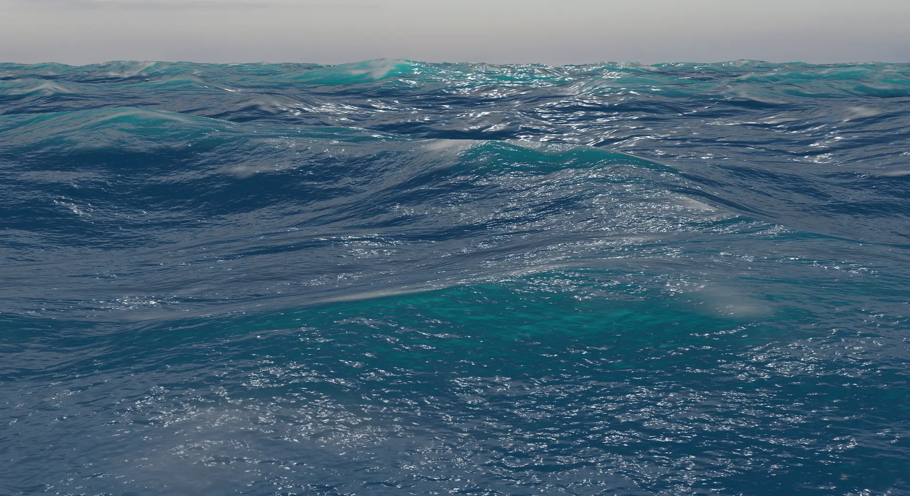
  <p><em>All four cascades summed together.</em></p>
</div>

There's one important rule: **the cascades must not overlap**. If two cascades both contain waves of the same wavelength, the energy of those waves gets added twice and that band becomes too strong. That's what the `lowCutoff` and `highCutoff` in `GenerateH0` from section 1.3 are for: every cascade only fills in the wave vectors inside its own band and leaves the rest at zero.

### 4.2 Splitting the Spectrum Between Cascades

So where do you draw the line between two cascades? In the `GenerateH0` snippet in section 1.3 you saw my first answer: a cascade starts where the previous, bigger cascade runs out of resolution (its Nyquist limit). That sounds efficient, since every cascade uses its full resolution. Funny enough, it turned out to be a bad idea.

The catch is that the shortest waves of every cascade are then only *two texels* long. Two texels are enough to store a wave's height, but not its shape. The normals and the Jacobian are computed from neighbouring texels, and with only two texels per wave they come out blocky and aliased. To make it worse, the shortest waves of the big cascade are exactly the ones that break and make foam, so the foam came out blocky too.

The fix (following gasgiant's FFT-Ocean) is to hand waves over to the next cascade earlier, so every wave is at least about six texels long in the cascade that owns it. The boundary between cascade $i$ and $i+1$ sits at the wave that fits **6 times** into the patch of the next cascade:

$$k_{i \mid i+1} = 6 \cdot \frac{2\pi}{L_{i+1}}$$

where $k_{i \mid i+1}$ is the boundary wavenumber (longer waves go to cascade $i$, shorter ones to $i+1$) and $L_{i+1}$ is the patch size of the next, smaller cascade.

<pre><code class="language-cpp">
// Boundary between cascades i and i+1 at 6 wavelengths per patch of i+1: every wave is >= ~6 texels long in its
// cascade. At the Nyquist limit the shortest waves were 2 texels long and their derivatives aliased.
const float boundaryFactor = 6.0f;
auto boundaryK = [&](UINT i) { return boundaryFactor * 2.0f * PI / m_oceanPatchSizes[i + 1]; };
const float lowCutoff = cascade == 0 ? 0.001f : boundaryK(cascade - 1);
const float highCutoff = cascade + 1 &lt; m_oceanCascadesNumber ? boundaryK(cascade) : highestK;
</code></pre>

The breaking waves now live in the 250 m cascade, where they have plenty of resolution:

<div class="centered">
<svg class="ocean-fig" viewBox="0 0 680 250" role="img" aria-label="Wavelength bands per cascade, before and after moving the split from the Nyquist limit to six wavelengths per patch">
<text x="60" y="38">Before: each cascade starts at the Nyquist limit of the previous one</text>
<rect x="62.6" y="46" width="262.7" height="34" fill="#1d4e89"/>
<text class="small on-dark" x="194.0" y="67" text-anchor="middle">1500 m</text>
<rect x="325.3" y="46" width="84.9" height="34" fill="#2f74b5"/>
<text class="small on-dark" x="367.8" y="67" text-anchor="middle">250 m</text>
<rect x="410.2" y="46" width="127.4" height="34" fill="#4fa3d9"/>
<text class="small on-light" x="473.9" y="67" text-anchor="middle">17 m</text>
<rect x="537.6" y="46" width="58.0" height="34" fill="#8fd0f0"/>
<text class="small on-light" x="566.6" y="67" text-anchor="middle">5 m</text>
<line class="accent" x1="325.3" y1="84" x2="325.3" y2="96"/>
<text class="small accent-text" x="325.3" y="108" text-anchor="middle">breaking waves, only 2 texels long</text>
<text x="60" y="140">Now: split at 6 wavelengths per patch of the next cascade</text>
<rect x="62.6" y="148" width="169.8" height="34" fill="#1d4e89"/>
<text class="small on-dark" x="147.5" y="169" text-anchor="middle">1500 m</text>
<rect x="232.4" y="148" width="127.4" height="34" fill="#2f74b5"/>
<text class="small on-dark" x="296.1" y="169" text-anchor="middle">250 m</text>
<rect x="359.7" y="148" width="58.0" height="34" fill="#4fa3d9"/>
<text class="small on-light" x="388.7" y="169" text-anchor="middle">17 m</text>
<rect x="417.7" y="148" width="177.8" height="34" fill="#8fd0f0"/>
<text class="small on-light" x="506.6" y="169" text-anchor="middle">5 m</text>
<line class="ink" x1="60" y1="196" x2="600" y2="196"/>
<line class="ink" x1="81.8" y1="196" x2="81.8" y2="202"/><text class="small" x="81.8" y="216" text-anchor="middle">1 km</text>
<line class="ink" x1="190.9" y1="196" x2="190.9" y2="202"/><text class="small" x="190.9" y="216" text-anchor="middle">100 m</text>
<line class="ink" x1="300.0" y1="196" x2="300.0" y2="202"/><text class="small" x="300.0" y="216" text-anchor="middle">10 m</text>
<line class="ink" x1="409.1" y1="196" x2="409.1" y2="202"/><text class="small" x="409.1" y="216" text-anchor="middle">1 m</text>
<line class="ink" x1="518.2" y1="196" x2="518.2" y2="202"/><text class="small" x="518.2" y="216" text-anchor="middle">10 cm</text>
<text class="small" x="330" y="240" text-anchor="middle">wavelength (log scale): longer &#8592;&#8195;&#8594; shorter</text>
</svg>
  <p><em>Which wavelengths each cascade owns, before and after moving the split.</em></p>
</div>

One thing to watch out for: `boundaryK` uses the patch size of the *next* cascade, so the cascades must be sorted **from largest to smallest**. I once reordered them the other way around, and the bands overlapped in some places and were empty in others: heavy tiling right next to water as flat as a mirror.

As for the sizes themselves: I started with three cascades (250 m, 17 m and 5 m), but once the ocean plane got bigger, the repeating 250 m patch was impossible to miss. Adding a 1500 m cascade on top filled in the long swells and hid the tiling.

### 4.3 Adding the 4th Cascade

Adding a cascade sounds like copy-paste work, and that's exactly where it went wrong. A new cascade means three new textures (displacement, slope and foam), new shader registers, a bigger descriptor table, another patch size in the constant buffer, and another set of samples in both the vertex and the pixel shader.

I copied the cascade 2 lines in both shaders and forgot to rename some of them, so "cascade 3" was sampling the cascade 2 textures at its own 5 m scale. Nothing crashed and nothing was black. The 17 m cascade was simply counted twice, and the real 5 m cascade was computed every frame and never used. The ocean just looked subtly *off*, which is the worst kind of bug.
<!-- TODO(author): add how you found it (RenderDoc showing two SRV slots bound to the same texture? Disabling cascades one at a time?). -->

If you add a cascade yourself, check in RenderDoc that every SRV slot points at a different texture. It takes a minute.

The second bug was a classic C++ one, caught by the D3D12 debug layer. I called `resize()` on the foam parameter vector and then filled it with `push_back()`. `resize()` already creates the elements, so the vector ended up twice as long as the root constants it was uploaded to. A single initializer list fixes it:

<pre><code class="language-cpp">
m_foamParameters = { cbv.foamDecay, cbv.foamBias, cbv.foamAdd, cbv.foamRange, cbv.deltaTime };
</code></pre>

### 4.4 World-Space UV Sampling

Each cascade is sampled with its own UV, computed from the world position divided by its patch size:

<pre><code class="language-cpp">
float2 uv0 = data.Position.xz / patchSize0; // 1500 m
float2 uv1 = data.Position.xz / patchSize1; // 250 m
float2 uv2 = data.Position.xz / patchSize2; // 17 m
float2 uv3 = data.Position.xz / patchSize3; // 5 m

float3 displacement = DisplacementTexture0.SampleLevel(linearWrapSampler, uv0, 0).rgb
                    + DisplacementTexture1.SampleLevel(linearWrapSampler, uv1, 0).rgb
                    + DisplacementTexture2.SampleLevel(linearWrapSampler, uv2, 0).rgb
                    + DisplacementTexture3.SampleLevel(linearWrapSampler, uv3, 0).rgb;
</code></pre>

Because the UVs come from the world position, every cascade tiles at its own size across the same ocean plane, no matter how big the mesh is. The UVs also go way outside the [0, 1] range, so, like I mentioned in section 2.1, you need a **WRAP** sampler. With my first CLAMP sampler, everything outside the first patch sampled the same edge value, and large parts of the ocean were perfectly flat.

The patch sizes reach the shaders through a small constant buffer, which gave me one of my favourite C++ bugs: I uploaded `&m_cascadeSizes` instead of `m_cascadeSizes.data()`. The first is the address of the `std::vector` object itself, so I was copying its internal pointers into the constant buffer, and the shader read those bytes as patch sizes.

The most subtle fix was hiding in plain sight in section 2.2. There, the pixel shader computed its UV from `IN.PositionWS`, the *displaced* world position. But the FFT textures are indexed by where a point *started*, not where it ended up after the horizontal displacement. With choppy waves, points move sideways by a metre or more, so the pixel shader looked up the normal and foam of a neighbouring point, and the foam sat *next to* the crests instead of on them. The fix is to pass the undisplaced position along from the vertex shader:

<pre><code class="language-cpp">
// ocean_vertex.hlsl
OUT.GridPosition = data.Position.xz; // the undisplaced position on the plane

// ocean_pixel.hlsl
float2 uv0 = IN.GridPosition / patchSize0;
float4 slope0 = SlopeTexture0.Sample(anisotropicSampler, uv0);
</code></pre>

For a calm ocean the difference is invisible, so the simple version in 2.2 is fine to get started. Once you add choppiness and foam, use the grid position.


## Chapter 5 Major Struggles & Lessons Learned

### 5.1 DX12 Resource Barriers & Synchronisation

If there's one thing that kept biting me throughout this project, it's synchronisation. In older APIs the driver tracks which resource is being read and written, and inserts the waits for you. DX12 makes that *your* job: resource barriers tell the GPU when a texture switches from being written by one pass to being read by the next. Forget one, and the GPU happily starts the next dispatch before the previous one has finished writing.

The ocean simulation is a long chain of compute passes on the same textures (animate the spectrum, horizontal FFT, vertical FFT, permute), with a UAV barrier needed between every step. Bugs caused by the barriers are hard to track down, because the result depends on timing: it can look fine for ten minutes and then glitch, or work on one GPU and break on another.

A fellow graphics programmer (Thank you M.O) took the time to explain race conditions and barriers to me properly, and afterwards I switched to "global" UAV barriers (a barrier on `nullptr`, which waits for *all* UAV writes) between the ocean passes. Slightly less precise, but much harder to get wrong. Eventually I built a small render graph into EV: every pass declares what it reads and writes, and the graph inserts the barriers. Almost all of my barrier bugs disappeared with it.
<!-- TODO(author): credit Manon by name here if you'd like (commit f129c15). -->

### 5.2 Theory Before Code

For this project I deliberately tried to understand the theory before writing the code: the FFT and its butterflies, the dispersion relation, the Jacobian, the split sum approximation. Was that worth it? Mostly, yes.

The best example is the foam. Because I understood that the Jacobian measures how much the surface is squeezed, I could reason about every foam problem: foam beside the crests means the lookup position is wrong, foam that doesn't know about the swell means the cascades need to be combined *before* the determinant. Without the theory I would have been tweaking sliders until it looked okay from one camera angle. The same goes for the split sum: at one point I applied Fresnel on top of the LUT, and the reflections at glancing angles came out far too bright. Knowing that the LUT already contains Fresnel is the only reason I found that bug.

It wasn't perfect though. Some bits I copied before I understood them, like the rounded $\omega$ in section 1.4, and some JONSWAP values came straight from gasgiant's implementation because they looked good.

What I'd do differently next time: build debug views much earlier. The foam debug views were one of the last things I added, and every foam bug would have been quicker to find with them. Theory tells you what *should* happen, the debug views will tell you what *actually* happens.

---

## Chapter 6 Results & Next Steps

### 6.1 Final Results

<div class="centered">
  <div style="position: relative; padding-bottom: 56.25%; height: 0; overflow: hidden; border-radius: 8px; box-shadow: 0 4px 12px rgba(0,0,0,0.1);">
    <iframe 
      style="position: absolute; top: 0; left: 0; width: 100%; height: 100%;" 
      src="https://www.youtube.com/embed/Bj9YD5zhjTY" 
      frameborder="0" 
      allow="accelerometer; autoplay; clipboard-write; encrypted-media; gyroscope; picture-in-picture" 
      allowfullscreen>
    </iframe>
  </div>
  <p><em>The final ocean.</em></p>
</div>

I'm really happy with how it turned out.
There's still plenty of room for improvement. The water has no depth to it (no refraction, nothing underneath), and the subsurface scattering is a clever fake, but it's still a fake. I'd love to compare it against a ground truth one day.

 Hidden for now: the author adds the measurements later. Delete this comment line and the endcomment tag below to show the section again.
**Some measurements**

| Metric | Value |
|--------|-------|
| Target framerate | 60+ fps @ 1920×1080 |
| GPU | AMD Radeon RX 9070 XT |
| Average frame time | TODO: measure |
| Ocean simulation GPU time (4 cascades) | TODO: measure |
| Ocean plane | 1024 m × 1024 m, 512×512 quads (2 m per quad) |
| FFT resolution | 512×512 per cascade |
| Cascade count | 4 (1500 m / 250 m / 17 m / 5 m) |

<!-- TODO(author): docs/path-tracing/performance.md already has measurements on the RX 9070 XT (Release, vsync off, default ocean scene in a ~1237x712 editor viewport): render graph GPU ~0.46 ms, frame ~0.86 ms (CPU-bound). Either re-measure at 1920x1080 for this table or quote those with their resolution. -->



### 6.2 Ocean Presets: One Simulation, Many Seas

One of my favourite things about the JONSWAP setup is how few parameters you need to completely change the character of the sea. I added a small set of presets to the ocean panel. A preset only changes the wind, the shape of the spectrum (gamma, swell, spreading), a few colors, the foam settings, and the skybox with its sun. The simulation code is exactly the same for all of them. The choppiness is the same in all presets.


<div class="centered">
  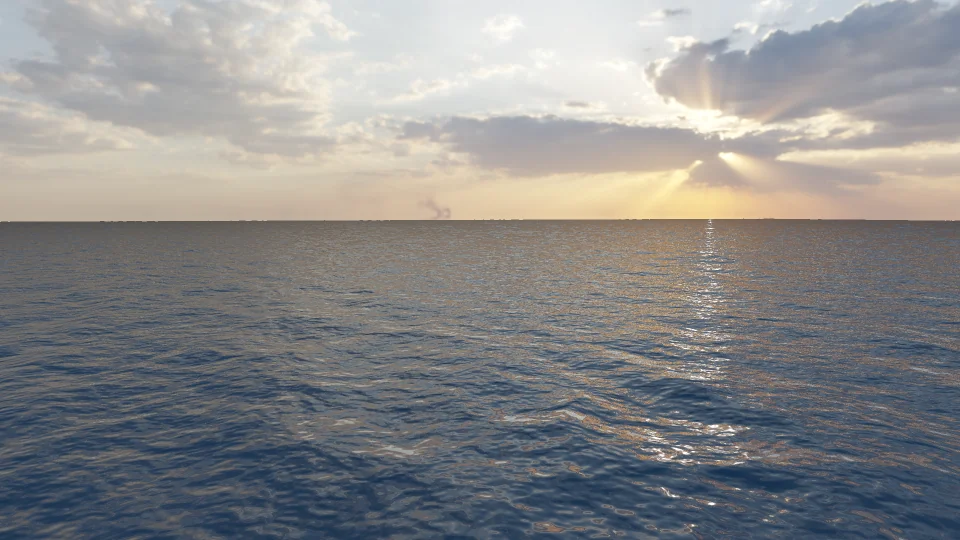
  <p><em>Default</em></p>
</div>


<!-- TODO(author): capture Tropical Lagoon from slightly above, looking towards the low back-light, so the turquoise water and glowing crests are visible. Save as presets/tropical-lagoon.webp -->
<div class="centered">
  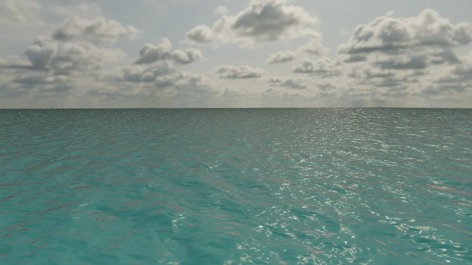
  <p><em>Tropical Lagoon</em></p>
</div>

<!-- TODO(author): capture Trade Winds from a bit higher up so the regular whitecap pattern under the cloudy sky is visible. Save as presets/trade-winds.webp -->
<div class="centered">
  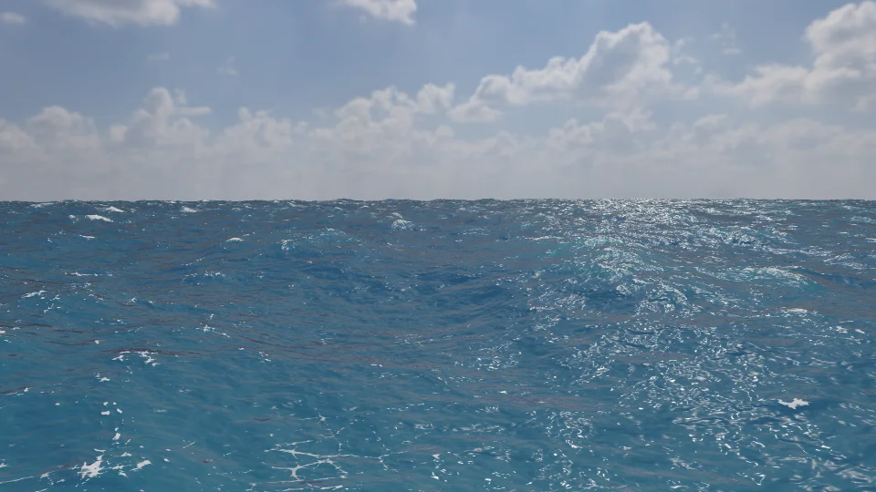
  <p><em>Trade Winds</em></p>
</div>

<div class="centered">
  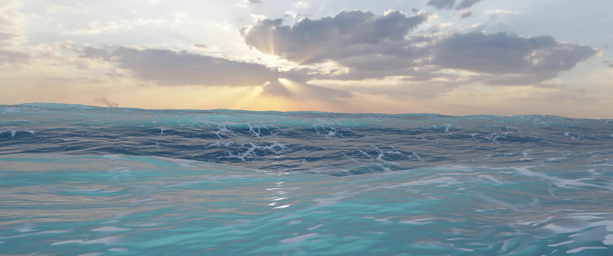
  <p><em>Long Swell</em></p>
</div>

<!-- TODO(author): capture North Atlantic under its cold, broken sky so the dark water and the lingering foam are visible. Save as presets/north-atlantic.webp -->
<div class="centered">
  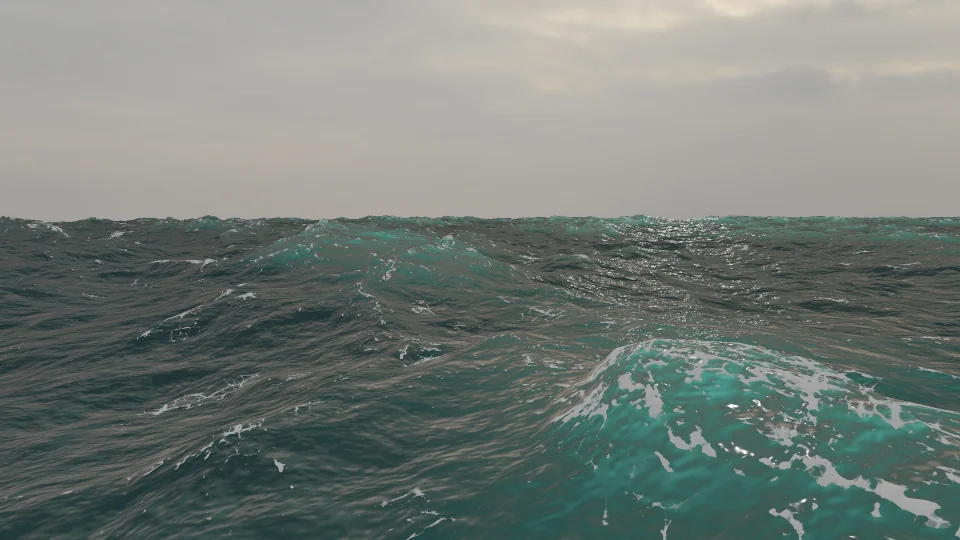
  <p><em>North Atlantic</em></p>
</div>

<div class="centered">
  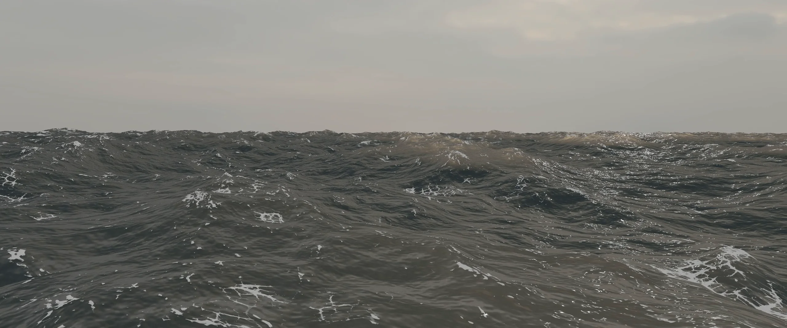
  <p><em>Troubled Ocean</em></p>
</div>

<!-- TODO(author): capture Storm under the overcast sky, so the confused crossing waves and the long foam streaks are both visible. A video would be ideal. Save as presets/storm.webp -->
<div class="centered">
  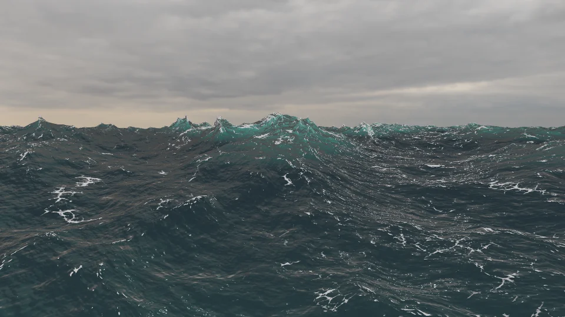
  <p><em>Storm</em></p>
</div>

<!-- TODO(author): capture Midnight looking towards the moon so the glitter path is visible. Save as presets/midnight.webp -->
<div class="centered">
  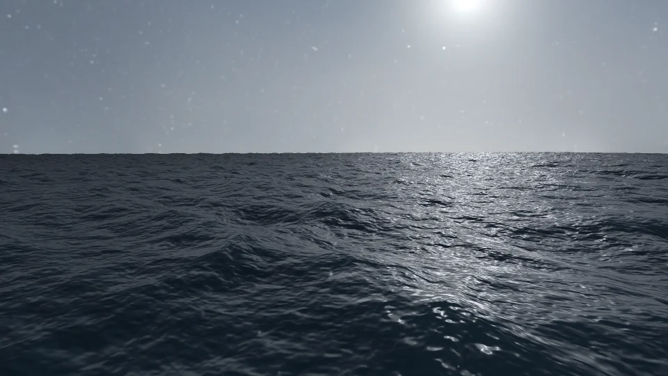
  <p><em>Midnight</em></p>
</div>

### 6.3 What's Next

- **Geometry clipmap LOD**: concentric rings of geometry centred on the camera, finer close by and coarser far away. There's a branch waiting for it.
- **H₀ on the GPU**: generate the initial spectrum in a compute shader, so the sliders and presets update instantly.
- **Refraction**: I'm currently building a path tracer in EV, and one of the planned side steps is ray traced refraction in the raster ocean, with absorption based on the real distance the light travels through the water.
- **A ground truth for the water**: a proper water material in the same path tracer, to tune the subsurface scattering fake from Chapter 2 against.
- **Caustics**: the light patterns that refracted sunlight draws on a seabed.
- **More profiling**: the render graph already times every pass on the GPU. Next up is the CPU side, with a profiler like Tracy.

---

That's it! If you made it all the way here, thank you for reading. Building this ocean taught me a lot about Fourier transforms, light and DX12, and it still makes me happy every time I fly over it. If you build your own ocean, or find a mistake in this post, I'd love to hear about it.

---

## References

1. [Tessendorf, J. (2001, revised 2004)](https://jtessen.people.clemson.edu/reports/papers_files/coursenotes2004.pdf). *Simulating Ocean Water.* SIGGRAPH Course Notes.
2. [Horvath, C. J. (2015)](https://doi.org/10.1145/2791261.2791267). *Empirical Directional Wave Spectra for Computer Graphics.*
3. [Garrett Gunnell (Acerola)](https://github.com/GarrettGunnell/Water). Water, FFT ocean and subsurface scattering shader.
4. [gasgiant](https://github.com/gasgiant/FFT-Ocean). FFT-Ocean.
5. [Fynn-Jorin Flügge.](https://tore.tuhh.de/bitstream/11420/1439/1/GPGPU_FFT_Ocean_Simulation.pdf) *Realtime GPGPU FFT Ocean Water Simulation.*
6. Bolba, G. [Ocean rendering blog post.](https://gikster.dev/posts/Ocean-Simulation/)
7. [Karis, B. (2013)](https://cdn2.unrealengine.com/Resources/files/2013SiggraphPresentationsNotes-26915738.pdf). *Real Shading in Unreal Engine 4.* SIGGRAPH Physically Based Shading course.
8. [LearnOpenGL: Specular IBL](https://learnopengl.com/PBR/IBL/Specular-IBL) and [Diffuse irradiance](https://learnopengl.com/PBR/IBL/Diffuse-irradiance).
9. [Mihelich, M. and Tcheblokov, T. (2019)](https://gpuopen.com/download/gdc-2019-agtd6-interactive-water-simulation-in-atlas.pdf). *Wakes, Explosions and Lighting: Interactive Water Simulation in Atlas.* GDC 2019.
