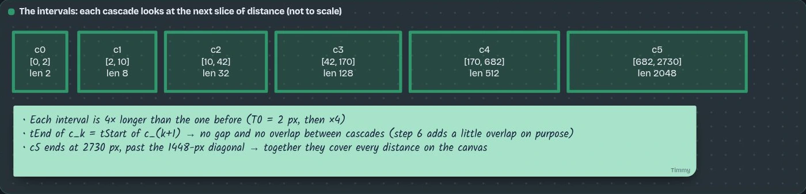
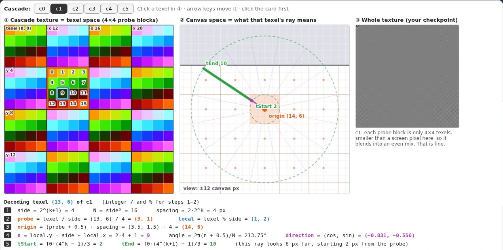
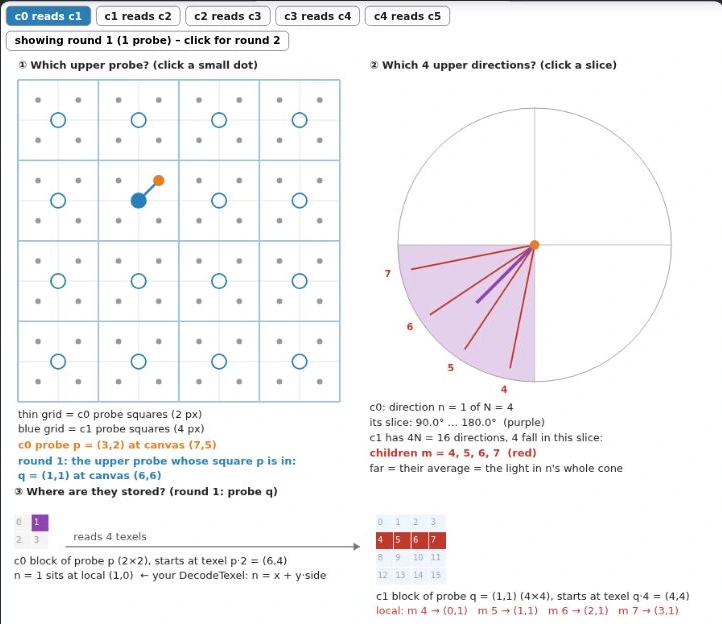
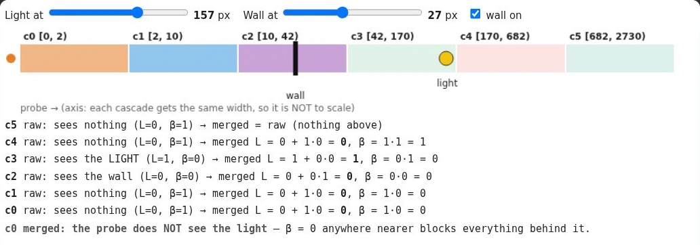
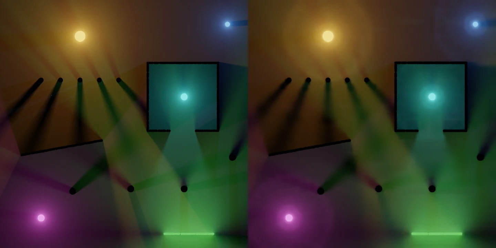
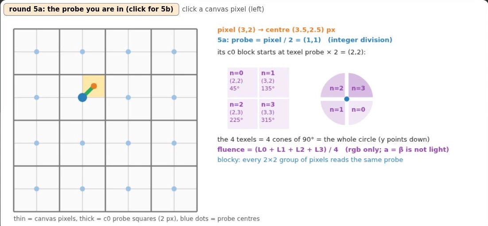
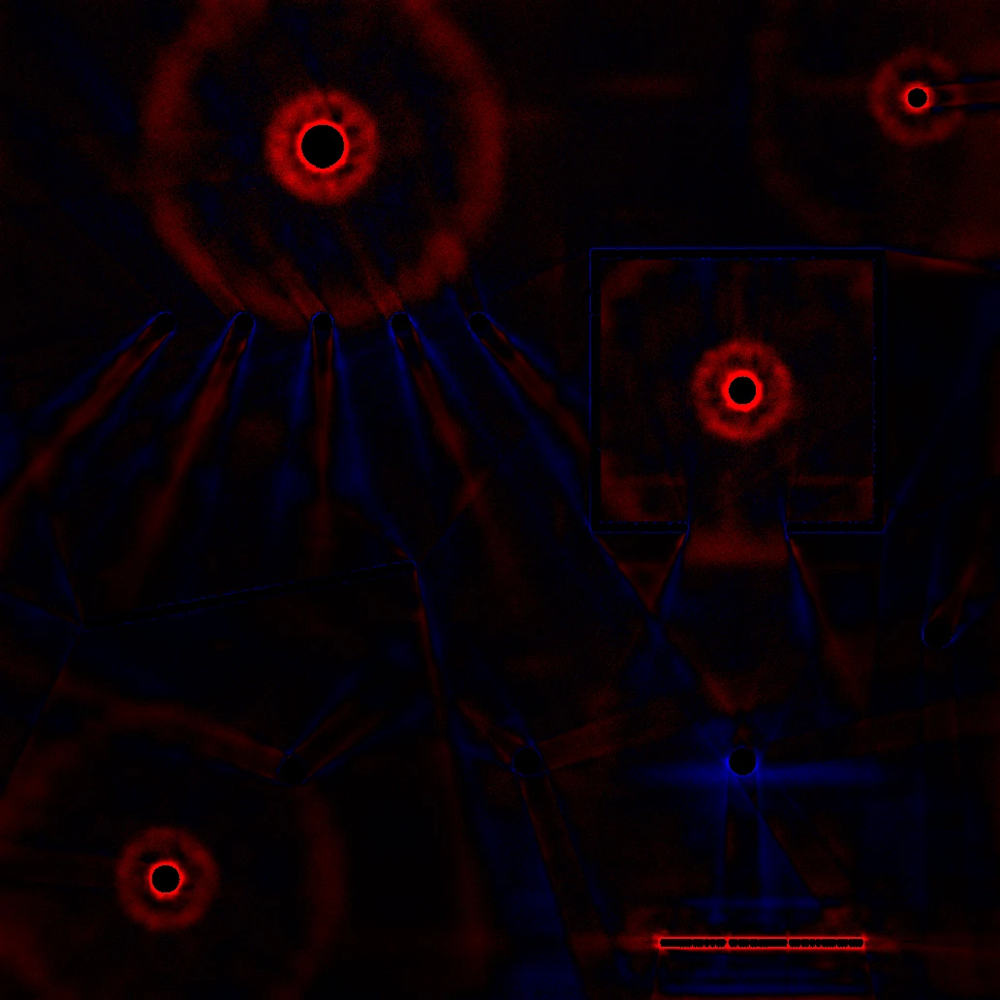

<!--
  EV Radiance Cascades project page (the 2D demo of EV's path-tracing project;
  the path tracer itself gets its own card once it works).
  Layout: the "project" layout (_layouts/project.html) with the same section
  types as the other project pages: .project-section (text + media side by
  side, "reverse" swaps the sides), .project-full-width, .section-divider.
  Media:
  - rc-*.webp / rc-painting.mp4: captured from EV's RC-0 panel (Release build,
    main PC), a scene painted with the brush tool.
  - board-*.webp: cropped from the interactive explainer boards made for each
    RC-0 step (Patroni).
  Images wrapped in <a class="image"> open full size when clicked, like on the
  other project pages.
-->

<!-- Two-column section: Overview text left, painting video right -->

## Overview

EV Radiance Cascades is a 2D demo of **radiance cascades** running in DX12 compute shaders inside [EV Engine](/projects/01-EV-Engine/). You paint lights and walls on a 1024×1024 canvas, and the light, with its soft shadows, updates in real time.

This mini project is a step towards a bigger goal. I'm working in EV Engine to create path tracing functionality. That project aims for a **spectral path tracer** as a feature of the engine that can be switched on and off. Next to it I want to **learn and fairly compare real time global illumination (GI) techniques**, such as radiance cascades, DDGI probes, ReSTIR and radiance caches, on both speed and image quality. Radiance cascades will be implemented **in 3D**, to achieve that, I needed to learn its core fundamentals before touching any 3D ray tracing. Afterall, reasoning in 2D is a lot simpler!

### What I built so far

- A paintable HDR canvas with a light, wall and eraser brush
- A brute force **reference** that converges to the ground truth over many frames
- Six **cascades** of probes, each tracing its own slice of distance
- Top down **merging** of the cascades: six dispatches ping ponging between two textures
- The final **fluence** pass, plus a difference view against the reference

<video controls autoplay loop muted playsinline preload="metadata" src="/assets/img/projects/EVPT/rc-painting.mp4"></video>

Painting lights and walls in the RC-0 panel (2× speed). Every frame is lit by radiance cascades.

<!-- Reverse section: the idea (penumbra observation + intervals) -->

## The idea: split every ray by distance

Brute force GI sends many rays from every pixel, and the cost grows with the resolution and the number of rays. Radiance cascades builds on a simple observation about soft shadows (the **penumbra**):

- **Close to a point**, the lighting changes quickly from place to place, but only a **few directions** are needed.
- **Far away**, it changes slowly from place to place, but you need **many directions** to resolve small, distant lights.

So the distance along a ray is cut into **intervals**, and each interval gets its own **cascade** of probes:

- **Cascade 0** has a probe every 2 px with 4 directions, and looks only 2 px far.
- Every cascade up has probes **2× further apart** per axis, **4× more directions**, and an interval **4× longer**.
- Six cascades together reach 2730 px, past the canvas diagonal.

Fewer probes × more directions keeps every cascade at exactly **1024² rays**. The total cost is about six times cascade 0, **no matter how many lights** are painted.

Each cascade looks at the next slice of distance, 4× longer than the last

<!-- Full width: decoding a cascade texel (wide explorer image) -->

## Gathering a cascade: one texel = one ray

Every cascade is stored in a single 1024² texture, and every GPU thread handles one texel. The first job of the shader is to find out which ray that texel stands for. The texture is laid out **probe first**: each probe owns a small square block of texels with one texel per direction. From the texel position the shader derives:

- **which probe** it belongs to (integer division by the block size) and where that probe sits on the canvas,
- **which direction** it points in (the position inside the block, numbered row by row),
- **which interval** it covers (start and end distance of that cascade).

It then marches the canvas pixel by pixel along that interval. It stores the light it found, plus a **transmittance** value: 1 if nothing was hit, 0 if a wall or light blocked the ray.
Note: These visualizations are made within a project im developing on the side. That project's goal is to create an environment for me where I can visualize my thoughts. It has AI integrated into it so the agent can help me understand topics like this.

A texel in the cascade texture (left) maps to the correlated ray on the canvas (middle) and the decoding maths (bottom)

<!-- Two-column section: merging -->

## Merging: gluing the intervals back together

On its own, each cascade only knows about its own slice of distance. **Merging** joins them into full rays, **from far to near**: cascade 5 first, then every cascade continues its rays with what the cascade above saw beyond its interval.

The merge is the same maths as **"over" alpha compositing**:

- L = Lnear + βnear · Lfar
- β = βnear · βfar

If something was hit nearby (β = 0), everything behind it is blocked. If the interval was empty (β = 1), the far light passes straight through.

Per texel, the shader reads the **4 child directions** of the cascade above (their average is the light through this ray's whole cone) from the **4 nearest upper probes**, blended bilinearly. The six merge passes run top down through EV's render graph, ping ponging between two textures so no pass reads and writes the same texture.

Which upper probe, which 4 child directions, and where they are stored

The merge along one ray: a wall in cascade 2 hides the light in cascade 3

<!-- Reverse section: fluence + reference -->

## From cascades to an image

After merging, every texel of cascade 0 holds the light arriving at its probe through one 90° cone, all the way out to 2730 px. The final pass turns that into what the eye sees, the **fluence**: the average light arriving at a point from all around.

- Each probe's 4 cones are averaged (together they cover the full circle).
- Every pixel blends the **4 nearest probes** bilinearly, so the probe grid doesn't show.
- A Reinhard tonemap maps the HDR result to the screen.

To check the result I also wrote a **brute force reference**. Every frame it shoots a few randomly rotated rays per pixel and keeps a running average, so it converges to the ground truth over a few thousand frames. Radiance cascades get a very similar image in a single frame.

Left: brute force reference after ~3000 frames. Right: radiance cascades, one frame.

Which probe a pixel reads, and which 4 texels make up a probe

<!-- Two-column section: artefacts (difference view) -->

## Where it's still wrong

The **difference view** shows where radiance cascades disagree with the converged reference: red is too bright, blue is too dark.

The rings around every light are **ringing**, the best known radiance cascades artifact. Probes of neighbouring cascades sit at different positions, so the far part of a ray starts from a slightly different point than the near part. Small, bright lights show it most.

Fixing this is the next step.

Difference view (×4): rings around the lights and light leaking at wall ends

<!-- Final full-width section -->

## Up Next

**Finishing RC-0**

- **Interval overlap**: let neighbouring intervals overlap slightly so light can't leak through thin walls
- **Bilinear fix**: trace from each probe towards each of the 4 upper probes it blends, instead of continuing one shared ray. This targets the ringing above.
- Experiment with the length of the first interval
- Measure: the same time for 2, 100 and 1,000 lights, and the cost per cascade on an AMD RX 9070 XT and an NVIDIA RTX 3070 Ti laptop GPU

**Then the path tracing project**

- DXR acceleration structures and ray query debug views
- An RGB reference path tracer, then spectral rendering with hero wavelength sampling
- Denoising, and the GI comparison: **3D radiance cascades** (where everything learned here comes back), DDGI probes, ReSTIR and radiance caches, all measured against the path traced reference

The techniques come from Alexander Sannikov's [Radiance Cascades paper](https://github.com/Raikiri/RadianceCascadesPaper) and these articles: [Fundamentals of Radiance Cascades](https://m4xc.dev/articles/fundamental-rc/), GM Shaders' [part 1](https://mini.gmshaders.com/p/radiance-cascades) and [part 2](https://mini.gmshaders.com/p/radiance-cascades2), and [jason.today](https://jason.today/rc).

<a href="https://github.com/TimethyH/EV/tree/path-tracing" target="_blank" class="btn btn-dark btn-lg btn-github" style="text-decoration: none;">
  <i class="fab fa-github" style="margin-right: 8px;"></i> View on GitHub
</a>

