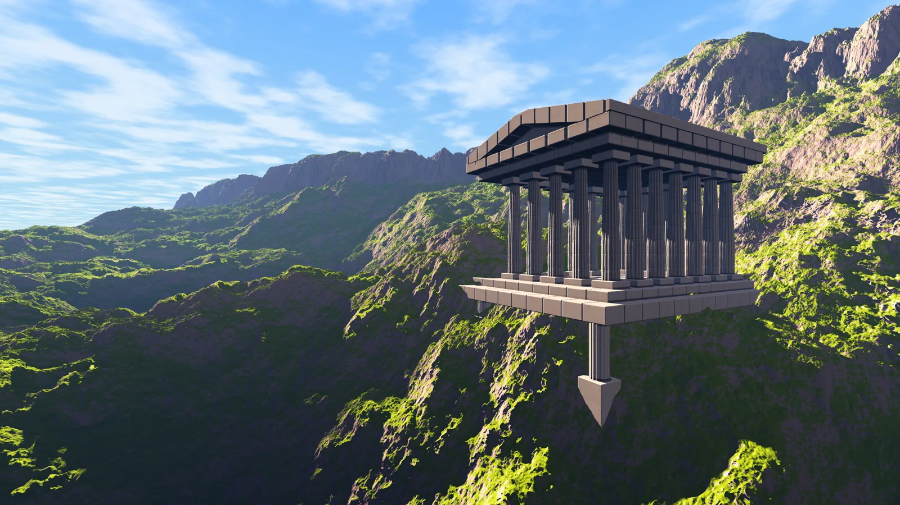
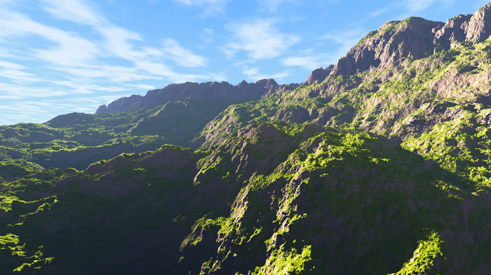
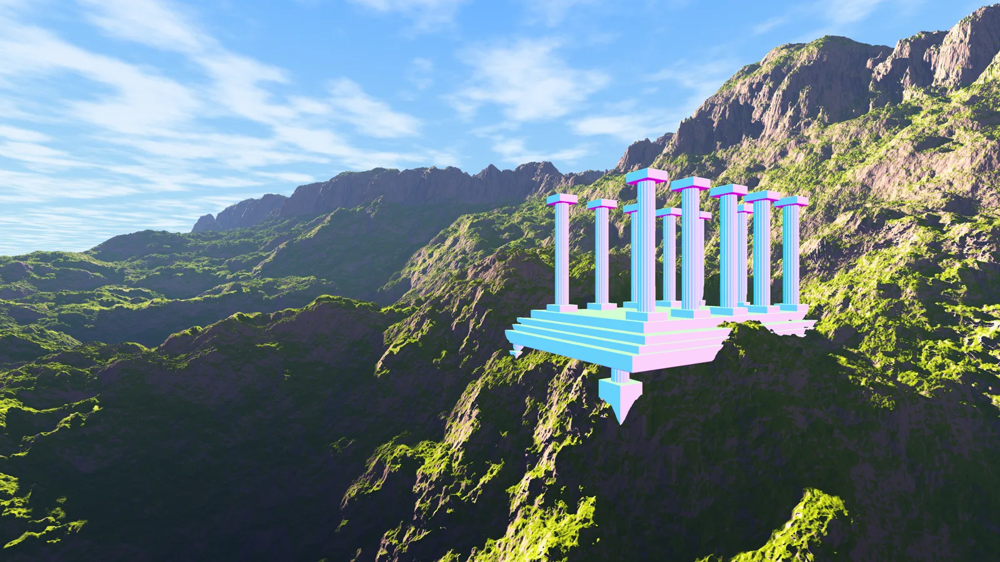

<!--
  Live shaders: each 
 shows its poster until the
  visitor presses play; only then are the .glsl file and the iChannel
  textures downloaded and run (assets/js/shader-player.js).
  The GLSL files are the Shadertoy "Image" tab, pasted unchanged.
-->

<!-- Two-column section: Overview text left, live Landscape Temple right -->

## Overview

Shadertoy is where I practise the fundamentals behind real-time rendering: signed distance fields, raymarching, procedural noise and lighting, all inside a single fragment shader.

These shaders are **educational recreations**. I follow [Inigo Quilez's](https://iquilezles.org) tutorials step by step, rebuild his techniques myself and comment every part until I understand why it is there.

Both shaders on this page **run live in your browser**. Press play to start one. They render at a lower resolution that adapts to your GPU, and pause when you scroll away.

### What I practised

- Raymarching heightfields and signed distance fields
- Fractal Brownian motion (FBM) with analytic derivatives
- Soft shadows, ambient occlusion and fresnel specular
- Modelling with SDF primitives, smooth booleans and domain repetition
- Triplanar and biplanar texture mapping

  

Landscape Temple: press play to run it live

<!-- Reverse section: progression images left, Landscape Temple text right -->

## Landscape Temple

A procedural mountain range with a Greek temple floating above it, rendered in a single raymarching loop that tracks whether the ray hit the terrain or the temple.

### Terrain

- **14 octaves of value noise** with quintic interpolation, each octave rotated so the layers don't line up into grid artifacts.
- **Analytic derivatives** carried through every octave give exact terrain normals without extra height samples.
- Cliff bands are stretched with a smoothstep. The raymarcher takes smaller steps near cliffs so it doesn't overshoot them.
- A flat pad is blended into the heightfield underneath the temple.

### Temple

- Built from rounded boxes and cylinders. The columns are fluted with `sin(16·atan)` and taper towards the top.
- Limited **domain repetition** turns a single column, stair tile and roof block into the whole colonnade, the stairs and the roof.
- A rhombus SDF forms the roof, with the pediment and grooves carved out of it.

### Lighting

- Sun, sky dome and bounce light.
- **Soft shadows**: a heightfield march for the terrain and an SDF march for the temple.
- Ambient occlusion and fresnel specular on the stone, plus triplanar texture mapping for surface detail.
- A sky with FBM clouds on a plane high above the scene, and exponential fog with a different falloff per colour channel.
- Four jittered samples per pixel for anti-aliasing.

The terrain on its own

Temple placed in the scene with a debug material

<!-- Two-column section: Gears text left, live Gears right -->

## Gears

A sphere of meshing gears that opens and closes around a copper core, following Inigo Quilez's gears tutorial.

### Modelling

- **One gear, eighteen times.** The scene evaluates the SDF of a single gear. Mirroring and swapping axes, plus 45° rotations, fold space so that one gear covers all six faces and all twelve edges of a cube.
- The 12 teeth come from **angular domain repetition**. Neighbouring gears are offset by half a tooth and spin in opposite directions so they mesh.
- The gear is clipped to a spherical shell with a **smooth maximum**, which also cuts the ring indent. Shell, crosses and connecting rods all animate with time.

### Shading

- Biplanar texture mapping for the brushed metal.
- Ambient occlusion and soft shadows.
- Three lights: a sky light with fresnel reflections, a warm key light with Blinn-Phong specular, and a bounce light from below.
- 2×2 supersampling.

  

Gears: press play to run it live

<!-- Final full-width section -->

## Results & Reflections

Recreating someone else's work line by line taught me more about SDFs than reading about them ever did. Deriving the noise derivatives and the smooth maximum by hand made the maths stick. The next step is to make original scenes of my own with these techniques.

All credit for the original techniques goes to [Inigo Quilez](https://iquilezles.org). The tutorials I followed: [landscape](https://www.youtube.com/watch?v=BFld4EBO2RE), [temple](https://www.youtube.com/watch?v=-pdSjBPH3zM) and [gears](https://www.youtube.com/watch?v=sl9x19EnKng).

<a href="https://www.shadertoy.com/user/polara" target="_blank" class="btn btn-lg btn-shadertoy" style="text-decoration: none;">
  <i class="fa-solid fa-cube" style="margin-right: 8px;"></i> View on Shadertoy
</a>

